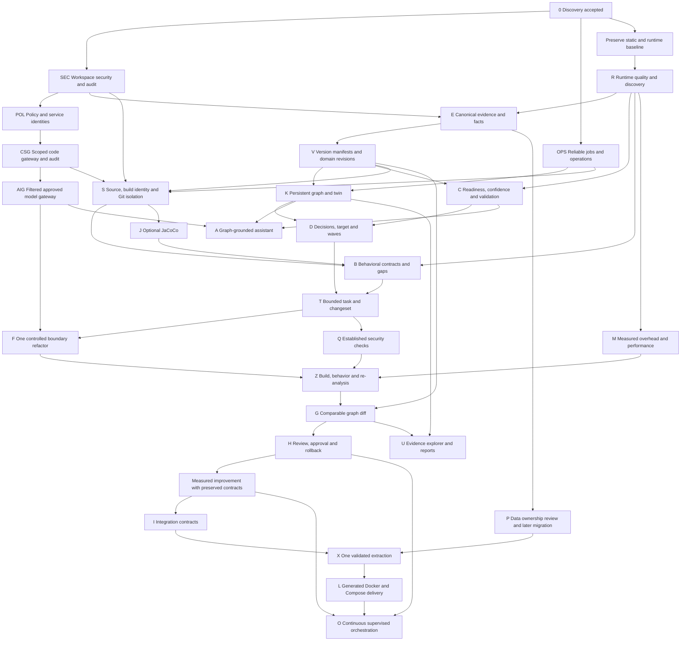
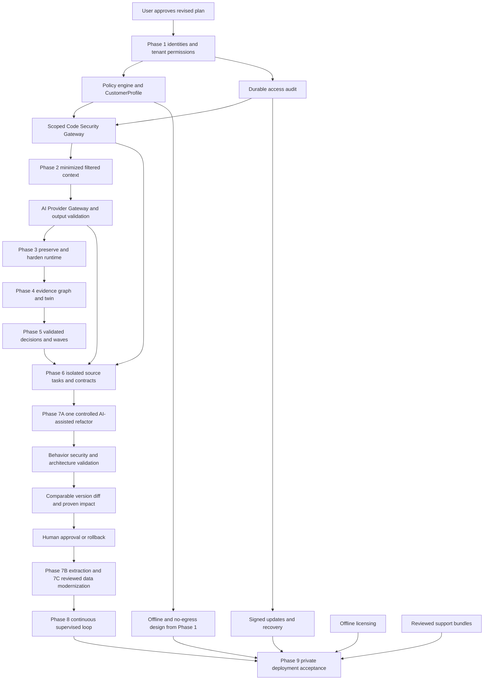

# ArchIntel implementation roadmap

> **Phase 9 checkpoint, 10 October 2026:** Phase 9 implementation has started with an explicit, audited local support-status export. The report is previewed before export and includes only allowlisted health/workflow states; it excludes source, secrets, logs, database/runtime payloads, and architecture/customer data. Docker/Compose, signed updates, licensing, encrypted restore, and air-gap acceptance remain pending. See [Phase 9 verification](PHASE-9-VERIFICATION.md), [user flow](PHASE-9-USER-FLOW.md), and [developer handoff](PHASE-9-DEVELOPER-GUIDE.md).

> **Phase 8 checkpoint, 10 October 2026:** Phase 7B has a read-only extraction-boundary preview; generation remains open. Phase 7C has discovery, generated target proposals, independent review and synthetic-only ephemeral SQLite validation; production migration, database-specific testing and recovery remain open. Phase 8 implementation has begun with a read-only supervised progress board for tasks under an architecture version. It reports blockers, validation freshness, and a suggested human next action; it does not execute or advance tasks. Full Phase 8 acceptance remains gated on validated Phase 7 extraction/migration slices and durable interrupted-task recovery. See [Phase 8 verification](PHASE-8-VERIFICATION.md), [user flow](PHASE-8-USER-FLOW.md) and [developer handoff](PHASE-8-DEVELOPER-GUIDE.md).

> **Phase 7 checkpoint, 10 October 2026:** Phase 7A includes expected-impact review, candidate `ArchitectureVersion` publication, and final human approval; runtime dependency coverage and acceptance remain open. Phase 7B has a read-only, version/source-bound extraction-boundary preview; actual module/service extraction is not yet implemented. Phase 7C now implements evidence-linked source discovery, generated target-schema/mapping proposals, independent ownership review bound to an exact plan fingerprint, and a synthetic-only ephemeral SQLite migration test. Production migration, database-specific Concord/PostgreSQL validation, backup/restore rehearsal and migration-job recovery remain open. Phase 7 work remains in progress. See [verification](PHASE-7-VERIFICATION.md), [user flow](PHASE-7-USER-FLOW.md) and [developer handoff](PHASE-7-DEVELOPER-GUIDE.md). Earlier Phase 6 acceptance gaps remain open.

> **Phase 6 checkpoint:** Controlled source tasks and the pinned local Docker build sandbox are implemented. A controlled Java/Maven fixture passed a real offline, non-root, network-disabled build and test. Full Phase 6 acceptance remains open: customer artifact reproduction and broader characterization/security/lineage capabilities remain pending. See [verification](PHASE-6-VERIFICATION.md), [user flow](PHASE-6-USER-FLOW.md) and [developer handoff](PHASE-6-DEVELOPER-GUIDE.md). Phase 7 was subsequently authorized; see the update above.

> **Phase 5 implementation update:** Modernization intelligence is implemented and validated for user verification: version-bound assessments, evidence-linked findings/decisions, separate readiness/confidence, target alternatives, dependency-first waves, an independent publication validator, planning review history and deterministic explanations. See [verification](PHASE-5-VERIFICATION.md), [user flow](PHASE-5-USER-FLOW.md) and [developer handoff](PHASE-5-DEVELOPER-GUIDE.md). No source transformation is enabled by this phase.

> **Microservice modernization update (11 October 2026):** Phase 5 planning exposes evidence-bound candidates; one-by-one candidates bind to approved source tasks; and a bounded Gemini structured-output adapter is in place with local secret configuration. Actual code dispatch remains disabled until source-transfer consent, candidate file mapping, standalone repository output, and isolated validation are wired. See [microservice modernization implementation](MICROSERVICE-MODERNIZATION-IMPLEMENTATION.md) and [Phase 7 verification](PHASE-7-VERIFICATION.md).

> **Phase 4 implementation update, 4 October 2026:** Evidence intelligence is implemented for verification: immutable version manifests/domain reviews, canonical evidence/facts/provenance, tracked guided discovery, separate persistent Neo4j projections and a bounded digital-twin workspace. PostgreSQL remains authoritative. See [verification](PHASE-4-VERIFICATION.md), [user flow](PHASE-4-USER-FLOW.md) and [developer handoff](PHASE-4-DEVELOPER-GUIDE.md). Earlier matrices remain the discovery baseline. Phase 5 was subsequently authorized; see its update above.

> **Phase 3 implementation update, 4 October 2026:** Runtime foundation hardening is delivered for verification: saved versioned instrumentation plans, exclusions/preview, strict optional service/artifact declaration binding, descriptor-aware coverage, ingestion quality, resource identity and lifecycle/retention recovery. See [verification](PHASE-3-VERIFICATION.md), [user flow](PHASE-3-USER-FLOW.md) and [developer handoff](PHASE-3-DEVELOPER-GUIDE.md). Real Java telemetry was validated in isolation. Broader runtime adapters/overrides remain listed in the handoff; Phase 3 results are historical; see the newer Phase 4 update above.

> **Phase 2 implementation update, 4 October 2026:** The user authorized the AI gateway phase. The local adapter, context filtering, model policy, citation validation, audit, source-range workflow and UI are implemented. Final verification is recorded in [PHASE-2-VERIFICATION.md](PHASE-2-VERIFICATION.md); see [user flow](PHASE-2-USER-FLOW.md) and [developer guide](PHASE-2-DEVELOPER-GUIDE.md). Phase 2 results are historical; see the newer Phase 3 update above.

> **4 October 2026 implementation update:** The user approved starting implementation. Phase 1 security foundation is implemented; see [verification](PHASE-1-VERIFICATION.md), [user flow](PHASE-1-USER-FLOW.md) and [developer handoff](PHASE-1-DEVELOPER-GUIDE.md). The assessment below records the pre-implementation baseline and future target. See the newer Phase 2 update above.

Planning revision 2, 3 October 2026, authorization updated 10 October 2026 — **PHASES 1 THROUGH 9 AUTHORIZED**. The enterprise master specification (attachment `f0e63c94-fde0-416d-8e73-c41c04e98fa7`) now governs security, customer-hosted deployment and phase order. The earlier complete specification (`8d1ac8de-ab7b-498b-951e-5794e30f3b7d`) remains the detailed functional baseline where compatible. Section 2 below retains its ORIGINAL specification numbering; section 9 maps the ENTERPRISE specification separately. The original mapping below is the planning baseline; the delivery updates above record subsequent implementation.

Read with [CURRENT_ARCHITECTURE.md](CURRENT_ARCHITECTURE.md), [ARCHINTEL_TARGET_ARCHITECTURE.md](ARCHINTEL_TARGET_ARCHITECTURE.md), and [ARCHINTEL_SECURITY_ARCHITECTURE.md](ARCHINTEL_SECURITY_ARCHITECTURE.md). This roadmap supersedes earlier phase sequencing without discarding working static/runtime features, completed reliability work, or original functional requirements. The user approved Phase 1 implementation. The user subsequently authorized Phases 2, 3 and 4. The user subsequently authorized Phases 5 and 6. Phase 6 is in progress; see the checkpoint above.

## 1. Status definitions

- **EXISTING:** a concrete current capability with code and relevant verification; this does not mean enterprise-ready or universally supported.
- **PARTIALLY_EXISTING:** useful implementation exists, but the specified contract or acceptance scope is incomplete.
- **NEW:** required capability with no working end-to-end implementation; it needs a new contract/workflow even if existing algorithms are reused.
- **LATER:** deliberately deferred beyond the first validated Java modernization slice; it is not implemented merely because it appears here.

Work-package IDs below link capability rows to dependencies, order, integration points, storage/API/UI effects, and tests. A prototype graph view is not classified as a knowledge graph; the static sequence view is not classified as an executable transformation plan.

## 2. Complete capability mapping

| Spec | Major capability | Status | Evidence / remaining work and work package |
|---|---|---|---|
| 0–3 | Existing-project inspection and incremental architecture | EXISTING | This discovery assessment; continue section-90 milestone reporting |
| 1–2 | Complete evidence-to-change-to-improvement chain | PARTIALLY_EXISTING | Analysis evidence exists; accepted fact/decision/change/validation lineage needs E, V, K, D, T, Z, G |
| 4 | Preserve static analysis | EXISTING | `scanner.py`, exporter, `engine.py`, pure algorithms and real packaging tests; no second scanner |
| 5 | Full target platform architecture | NEW | Proposed in companion document; delivered incrementally through packages below |
| 6 | Real dynamic analysis using OTel | EXISTING | Runtime receiver/services and historical real Java-agent validation; harden via R |
| 7 | BOUNDARY/STANDARD/DEEP instrumentation | PARTIALLY_EXISTING | Modes and include prefixes exist; exclusions, explicit budgets/coverage of boundary types need R |
| 8 | Static-guided RuntimeInstrumentationPlan | PARTIALLY_EXISTING | Explicit method selection exists; persisted plan/provenance and expanded prioritization need R |
| 9 | RuntimeAnalysisSession | PARTIALLY_EXISTING | Existing lifecycle, counters, selection; no persisted CONNECTED state or full health contract; R |
| 10 | Normalized runtime event model | PARTIALLY_EXISTING | Sanitized HTTP/method/database/message/cache/scheduler signals; expand only with observed fields, R |
| 11 | Runtime class/package/domain graphs | PARTIALLY_EXISTING | Graphs and class-edge statistics exist; projected statistics/session provenance need R, E |
| 12 | StaticRuntimeMapper | PARTIALLY_EXISTING | Exact/normalized/Spring proxy/unresolved; descriptors, other proxies, reviewed overrides need R |
| 13 | Separate runtime coverage dimensions | PARTIALLY_EXISTING | Five observation dimensions exist; quality states/scenario scope and uncertainty need R, C |
| 14 | CoverageProvider / JaCoCo | NEW | No code-coverage import/provider; J |
| 15 | Guided Runtime Discovery | PARTIALLY_EXISTING | Domain suggestions exist; prioritization, target evidence, tracked status need R, E |
| 16 | First-class Evidence | NEW | Inline snapshots/span refs are not canonical evidence records; E |
| 17 | ArchitectureFact / evidence classifications | PARTIALLY_EXISTING | Fusion classifications exist; durable facts and support/conflict relations need E |
| 18 | Persistent Architecture Knowledge Graph | NEW | Embedded disposable scan graph only; K |
| 19 | Architecture Digital Twin | NEW | Current graphs are inputs; versioned queryable twin and transformation context need V, K |
| 20 | Runtime flow intelligence | PARTIALLY_EXISTING | Route + class-set aggregates; ordered/messaging/external/data context need R |
| 21 | Data/persistence intelligence | PARTIALLY_EXISTING | Structural repositories and observed resource-sharing candidates; reviewed ownership/write/transaction context need R, P |
| 22 | Evidence/confidence-backed findings taxonomy | PARTIALLY_EXISTING | Static rules and runtime risk summaries exist; unified rule-versioned findings need E, C |
| 23–24 | Bounded specialized analyzers/agents | PARTIALLY_EXISTING | Deterministic structural/runtime/data services exist; typed proposal contracts and validation boundaries need A, C |
| 25 | Validation Agent | NEW | No independent conclusion-publishing validator; C (rules first), A |
| 26 | Independent readiness and confidence | PARTIALLY_EXISTING | Separate fields and unknown-runtime fallback; calibrated multidimensional confidence needs C |
| 27 | Structural/runtime/combined readiness | PARTIALLY_EXISTING | Deterministic configurable scores exist; richer components, provenance and reviewed calibration need C |
| 28 | Modernization Decision Engine | NEW | Scoring/risk strings are not typed decisions/actions/prerequisites; D |
| 29 | Reviewed target architecture | NEW | No explicit modular-monolith/service/hybrid target model; D |
| 30 | Modernization waves | PARTIALLY_EXISTING | SCC dependency-first structural waves exist; executable prerequisites, confidence, expected impact need D |
| 31 | ModernizationFactory | NEW | No transformation subsystem; bounded T, S, B, Z, G before extraction |
| 32 | ModernizationTask | NEW | No persisted constrained task model; T |
| 33 | Task state machine | NEW | Analysis states cannot substitute for transformation states; T |
| 34 | Risk model and approval policy | NEW | Difficulty scores are not task risk authorization; T, H |
| 35 | Characterization testing | NEW | ArchIntel tests are not customer behavioral tests; B |
| 36 | BehavioralContract | NEW | No customer behavior contract model; B |
| 37 | Test Gap Intelligence | NEW | Observation coverage is not validated behavior coverage; B, J |
| 38 | Controlled code transformation | NEW | No source intake/edit engine; S, T, F |
| 39 | ModernizationChangeSet | NEW | No patch/commit/validation lineage; T, S |
| 40 | Boundary refactoring | NEW | No working source recipe and validation loop; F |
| 41 | Service extraction | NEW | Follow a validated boundary-refactoring slice; X |
| 42 | Data modernization | NEW | Observed database calls are not migration plans; P |
| 43 | API/event/local-module contract engine | NEW | No generated reviewed contracts; I |
| 44 | Integration transformation | NEW | No validated direct-call-to-API/event rewriting; I, X |
| 45 | Generated application structure | NEW | Current product/sample layouts are not generated modernized output; X, L |
| 46 | Customer build validation | NEW | Product build/scanner tests exist; isolated customer baseline and changed builds need S, Z |
| 47 | Behavioral equivalence | NEW | No before/after customer behavior harness; B, Z |
| 48 | Transformation validator | NEW | No end-to-end build/behavior/architecture/security gate; Z, Q, M |
| 49 | Architecture re-analysis after a change | PARTIALLY_EXISTING | Existing scanner can analyze another artifact; source/task/version linkage needs S, V, Z |
| 50 | ArchitectureVersion | PARTIALLY_EXISTING | Stored runs preserve static history, but no unified lineage/context manifest; V |
| 51 | ArchitectureGraphDiffEngine | NEW | No stable correspondence/delta engine; G |
| 52 | Continuous modernization | NEW | First manual-supervised loop via Z/G/H; automated progression later via O |
| 53 | ModernizationOrchestrator | LATER | Deliver explicit task states first; O |
| 54 | Human approval controls | NEW | No approve/reject/request-change/pause/resume model or UI; H, T |
| 55 | Reversible Git rollback | NEW | Git installed, workspace not a Git repository; customer isolation and rollback need S, T, H |
| 56 | Generated-code security validation | NEW | Product upload protection is not code security scanning; Q |
| 57 | Measured transformation performance | NEW | No baseline/candidate benchmark harness; M |
| 58 | Generated service containerization | NEW | ArchIntel's Dockerfile is not a service generator; L |
| 59 | Provider-neutral CI/CD generation | LATER | After reliable local validation/package output; L |
| 60 | Deployment generation | NEW | Initial Docker/Compose generation/validation via L; Kubernetes/Helm/Terraform/cloud breadth LATER |
| 61 | Graph-grounded architecture assistant | PARTIALLY_EXISTING | Deterministic citations and optional Ollama ID selection; durable graph retrieval/validated generation need A |
| 62 | Explain decision | PARTIALLY_EXISTING | Current metric/risk explanations; full decision -> finding -> fact -> evidence chain needs E, D, U |
| 63 | Explain code change | NEW | No changesets/evidence lineage; T, U |
| 64 | Graph as persistent agent memory | NEW | No persistent architecture graph; K, V, A |
| 65 | Extend product navigation | PARTIALLY_EXISTING | Static/runtime views exist; new views added with working backends through U |
| 66 | Modernization Control Center | LATER | Basic task review first; consolidated orchestration after validated slices, O/U |
| 67 | Bidirectional Evidence Explorer | NEW | Current source/span links do not provide full chain traversal/filtering; U, E, K |
| 68 | Before/current progress UI | NEW | No comparable version/diff/behavior verdict; G, U |
| 69 | Security/privacy and enterprise access | PARTIALLY_EXISTING | Allowlisting, ingestion tokens, browser/host checks; authentication/authorization/audit/TLS/retention need SEC |
| 70 | Performance/backpressure/overhead | PARTIALLY_EXISTING | Caps, counters, bounded scanner exist; distributed scheduling and measured overhead/capacity need OPS, R, M |
| 71 | Reconstructable audit | NEW | Operational logs/stage timings are not actor-attributed audit history; SEC, H |
| 72 | Regression/integration/graph/runtime tests | PARTIALLY_EXISTING | Existing suite; new evidence/version/transformation/rollback/diff/agent tests accompany each package |
| 73 | Forty-step real Java modernization demo | PARTIALLY_EXISTING | Historical static + real runtime/coverage/fusion demo; full source-to-validated-improvement path below is NEW |

Remaining specification coverage:

| Spec | Obligation | Status / disposition |
|---|---|---|
| 74 | Phase 0 discovery | EXISTING upon completion of these three assessed documents and verification record |
| 75–85 | Phases 1–11 | Mapped explicitly in the phase plan below; not assumed complete from phase names |
| 86 | Short end-to-end MVP | NEW; shortest vertical path defined below |
| 87 | Do not build early | LATER: .NET/Python modernization, cloud breadth, Kubernetes/Terraform, IDE/Jira, billing/marketplace, autonomous production deployment, agent swarms |
| 88 | Complete-platform outcomes 1–45 | Covered by capability rows 4–73; no completeness claim until corresponding acceptance evidence exists |
| 89 | Non-negotiable rules | Mandatory invariants across all packages; existing safeguards preserved, transformation rules enforced before source changes |
| 90 | Milestone working method | Apply pre/post implementation template in section 7 below |
| 91 | First execution instruction | Discovery only; dependency graph and minimal vertical path included; stop after reporting |

## 3. Dependency-ordered work packages

Every NEW capability above resolves to one or more packages here. Order numbers are dependency stages, not calendar promises. Proposed paths/endpoints are not already created. DB means authoritative relational records; graph means persistent Neo4j projection, never the disposable scanner store. Every new capability includes scoped authorization, input validation, and regression checks in addition to its listed tests.

### SEC — secure workspace foundation (order 1)

- Dependencies: discovery; precedes team exposure and privileged source execution.
- Existing integration: `main.py`, `api.session/get`, runtime session ownership/rotation/purge, `models.py`, `App.tsx`, `api.ts`.
- DB: accounts/workspaces/memberships, sessions or identity bindings, audit events; explicit migration of existing local ownership. Graph: workspace scoping contract before projection.
- API: authentication, membership/roles, scoped dependencies on every route; audit access. UI: bootstrap/login/workspace context and permission states.
- Tests: anonymous/role denial, cross-workspace list/direct/indirect/export/token access, session revocation, browser protections, preserved local-data migration, sensitive-log exclusion.

### OPS — reliable execution and release operations (order 1)

- Dependencies: existing recovery checkpoint; SEC before shared administration.
- Integration: `pipeline.py`, `scanner.py`, runtime retention, health/ready, start/stop scripts, Compose.
- DB: durable jobs/leases/attempts/cancellation and retention records. Graph: projection worker retry status later, no scan-store redesign.
- API: retry/cancel/job diagnostics and admin retention. UI: existing progress component gains supported actions and setup diagnostics.
- Tests: worker crash/restart/fencing, duplicate delivery, cancellation cleanup, failed runtime retention, disk bounds, fresh install, backup/restore, supported container startup. Existing single-process behavior remains until distributed ownership passes.

### R — runtime quality and guided discovery (order 2)

- Dependencies: existing runtime pipeline; E/V for durable recommendation provenance.
- Integration: runtime schemas/routes; mapping, coverage, graph builder, normalization, intelligence, session service, runtime UI.
- DB: versioned instrumentation plans and exploration recommendations/status; observation metadata. Graph: typed observed relationships and support references via E/K.
- API: plan preview/exclusions, mapping diagnostics/approved overrides, scoped discovery recommendations and observation comparisons. UI: instrumentation review and guided scenario queue.
- Tests: supported boundary annotations, overload descriptors/proxies, missing/late spans, dropped data, truthful scope, workload expansion and coverage improvement on real Java; never unobserved -> unused.

### E — canonical evidence, facts, findings (order 2)

- Dependencies: existing static/runtime outputs; SEC scope contract.
- Integration: adapters reading `AnalysisRun.result`, runtime aggregates, existing issue/scoring outputs; preserve source snapshots.
- DB: structured evidence, facts, support/conflict links, findings, derivation versions and manifests, outbox. Graph: corresponding labels/relations projected by K.
- API: scoped evidence/fact/finding retrieval and backward-compatible evidence links. UI: source details and provenance on existing findings.
- Tests: idempotent backfill, no duplicate evidence on retries, bounded/expired source references, cross-baseline rejection, immutable historical outputs, exact A/B/C/D/X fusion invariant.

### V — architecture version and reviewed domain identity (order 2–3)

- Dependencies: E; existing analyses/session IDs.
- Integration: immutable static snapshots, selected-session fusion, domain membership, existing analysis selector.
- DB: architecture manifests/lineage and domain revisions; source/build linkage when S arrives. Graph: version-scoped identities, explicit lineage, no overwriting previous facts.
- API: create/read version manifest, preview/review domain revisions, compatibility checks. UI: version selector, reviewed domain edits and scope banner.
- Tests: selection/config/hash reproducibility, old snapshot compatibility, stable domain identity versus membership changes, no cross-version contamination, invalidation of dependent assessments/plans.

### K — persistent graph and digital twin (order 3)

- Dependencies: E/V; operational service provisioning through OPS.
- Integration: new projection/query repository alongside existing scanner; twin facade consumes versioned graph and operational state.
- DB: outbox projection attempts/state/content hashes. Graph: scoped constraints/indexes, supported entity/fact/evidence/finding nodes; idempotent edges; rebuild capability.
- API: bounded versioned graph/twin queries and provenance traversal; never arbitrary client Cypher. UI: extend architecture explorer with supported twin/evidence views.
- Tests: replay/rebuild consistency, graph outage/stale version detection, tenant query isolation, complete provenance traversal, bounded query performance; no impact on legacy scan graph.

### J — optional JaCoCo coverage provider (order 3, optional for first low-risk slice)

- Dependencies: V and source/build identity S for exact report binding.
- Integration: existing observation coverage presentation, a new provider adapter rather than replacing OTel coverage.
- DB: report digest, build/version binding, method/line/branch counters and provenance. Graph: coverage evidence linked to known entities, never inferred CALLS edges.
- API: bounded report import/status. UI: distinct code coverage tab/dimensions and incompatible-report errors.
- Tests: malformed/oversized reports, parser entity-expansion protection, class/descriptor matching, incompatible build rejection, unknown denominator, tracing versus code coverage separation.

### C — confidence, readiness calibration and conclusion validation (order 3–4)

- Dependencies: E/V; R supplies observation quality; J optional.
- Integration: `modernization.py`, runtime `intelligence.py`, issues and coverage functions; preserve old scoring versions.
- DB: assessment versions, component evidence, calibration/rule version, validation results/status. Graph: assessment/finding/evidence support and conflict relations.
- API: readiness/confidence breakdown and conclusion validation. UI: separate confidence, limitations and missing-observation explanations.
- Tests: arithmetic fixtures, unchanged structural scores, unavailable runtime fallback, low coverage affects confidence independently, unsupported/conflicting conclusions blocked, reviewed calibration cases. No LLM numerical scoring.

### D — decisions, target architecture and waves (order 4)

- Dependencies: E/V/C; K for graph-backed context; domain revisions reviewed.
- Integration: existing dependency-first SCC waves, domain/assessment UI; extend rather than re-sort solely by score.
- DB: decisions/actions/prerequisites, target architecture, plans/waves and review versions. Graph: REQUIRES/BLOCKED_BY/PRECEDES and evidence-backed decision relations.
- API: decision generation, explain-why, target/plan preview and reviewed revision. UI: alternative strategy, blockers and explicit plan review.
- Tests: cycle groups remain coupled, dependencies precede consumers, insufficient evidence selects observation/review, modular-monolith option, stale context invalidation and reproducible decision explanations.

### S — source/build onboarding and Git isolation (order 4–5)

- Dependencies: SEC/OPS; V for source-bound baseline. Required before any transformation.
- Integration: new source adapter feeds existing artifact upload/scanner pipeline; existing validation scripts are examples, not production source connectors.
- DB: repository/source revisions, build recipes/results/artifact hashes, worktree ownership. Graph: source/build provenance attached to architecture versions.
- API: authorized repository registration, pinned source import, baseline build job. UI: source/commit selection, diagnostics and artifact match.
- Tests: protected/dirty branch preservation, path/symlink containment, credential redaction, exact commit/build binding, failed baseline stops progression, isolated process/network/resource limits, safe cleanup/recovery.

### B — contracts, characterization tests and test gaps (order 5)

- Dependencies: S/V/E; R provides observed scenarios; existing customer tests.
- Integration: new contract/test adapter beside runtime flow view; reuse safe observations without collecting raw production payloads.
- DB: behavioral contracts, scenario/fixture sources, generated-test proposals, validation coverage and critical gaps. Graph: contracts SUPPORTED_BY evidence and coverage of entry points.
- API: contract preview/review, scenario inventory, gap assessment. UI: known/observed/tested/unvalidated distinctions.
- Tests: unchanged-baseline characterization, safe fixture generation, output/error/event/data-effect assertions, missing critical behavior blocks risky tasks, generated tests do not erase unknown business requirements.

### T — tasks, state machine and changesets (order 5)

- Dependencies: D/V/S/B; SEC/OPS.
- Integration: separate task service using reliable jobs; never reuse AnalysisRun statuses as transformation states.
- DB: task constraints/risk/dependencies/transitions, changesets, validation requirements, approval policy references. Graph: task/action/decision/changeset lineage.
- API: create/validate task, preview exact patch, state/status/history, pause/resume with policy. UI: task list and scoped file/patch review.
- Tests: legal transition matrix, failed prerequisites, atomic claim/idempotency, stale branch/hash invalidates approvals, protected-file denial, no chat-driven state changes.

### F — one controlled boundary transformation (order 6)

- Dependencies: S/B/T, D decision and reviewed baseline, Z available to validate output.
- Integration: new bounded recipe/AST adapter; reuse scanner/metrics to assess resulting artifact.
- DB: recipe/version/inputs and generated changeset references in T. Graph: intended boundary change versus observed post-change facts.
- API: dry-run/proposal and task execution, not unrestricted repository rewrite. UI: before/after patch with explain-change links.
- Tests: one real Java fixture, successful compile/tests, unrelated code preserved, expected architectural change and failure/rollback cases. Select a suitable candidate from actual source evidence; do not invent a cycle to remove.

### I — integration contracts and transformations (order 6–7)

- Dependencies: B/D/T and observed transaction/data/latency constraints; F precedes distributed extraction.
- Integration: domain dependencies/flows plus bounded source recipes.
- DB: versioned local interface/OpenAPI/event contracts, compatibility checks, approved integration choices. Graph: interface/event entities, implementation and dependency evidence.
- API: contract proposal/review and compatibility validation. UI: compare local, synchronous and asynchronous choices with constraints.
- Tests: API/schema compatibility, error and ordering behavior, retries/idempotency, transaction/consistency gaps block unsupported remote conversion. Start with local interface before REST/event breadth.

### X — one validated extraction (order 7)

- Dependencies: F/I/B/T/Z/Q, reviewed data ownership; M where performance-sensitive.
- Integration: new extraction adapter, source/build workers, existing re-analysis pipeline.
- DB: extraction plan/output artifacts, task/changeset/validation linkage. Graph: target module/service boundary and validated evolution.
- API: bounded plan and task execution. UI: inspect generated source/build/config/contracts/tests and validation status.
- Tests: one simple reviewed domain/module, real generated build and running application, preserved contracts, no forbidden coupling/shared-data change, reversible failure. No extraction-complete flag merely for generated files.

### P — data ownership and modernization (order 8; evidence review earlier)

- Dependencies: R/E/V/D plus source/schema evidence and reviewed ownership; X only after its data prerequisites pass.
- Integration: existing structural repositories and runtime database view.
- DB: ownership assertions, conflict reviews, DataOwnershipPlan, migration/validation/recovery proposals. Graph: ACCESSES/READS_FROM/WRITES_TO with evidence and declared ownership.
- API: ownership review and migration plan preview; production apply remains explicitly approved. UI: resource identity, writes, conflicts, recovery prerequisites.
- Tests: qualified resource identity, missing transaction context abstention, cross-domain writes, test-environment migration/data invariants, backup/restore/recovery and destructive-action gate. Git revert cannot stand in for data rollback.

### Z — transformation validation and re-analysis (order 5–6; grows with task types)

- Dependencies: S/B/T/V; existing scanner; Q mandatory for accepted code changes; M when required.
- Integration: customer build/test adapters invoke existing static engine on newly compiled artifacts and runtime receiver for required scenarios.
- DB: tool/check results, hashes/logs, baseline/candidate comparisons, required-gate manifest. Graph: VALIDATED_BY and new architecture version provenance.
- API: validation jobs/results with explicit PASS/FAIL/NOT_RUN/INCONCLUSIVE; task gating. UI: reproducible validation matrix and raw sanitized evidence.
- Tests: compile/test/behavior failure prevents approval, artifact-source mismatch rejected, rerun idempotency, deterministic re-analysis, baseline and candidate scenario alignment.

### G — graph diff, progress and improvement verdict (order 6, pulled forward from phase 9)

- Dependencies: V/E, baseline/candidate outputs from Z; reviewed entity correspondence.
- Integration: normalized graph IDs, SCCs, metrics, findings, assessments; preserve dependency direction and abstraction levels.
- DB: diff input manifest, deltas, comparison eligibility, expected-impact and behavior verdict. Graph: EVOLVED_TO and evidence-backed change relationships.
- API: compare versions, explain delta, improvement/regression/unchanged/inconclusive. UI: progress comparison with coverage/context differences visible.
- Tests: added/removed dependencies/cycles/blockers, rename versus deletion, domain membership change, changed algorithm/settings, unequal workloads cannot imply removed runtime behavior, score improvement alone insufficient.

### H — human review, approval and rollback (order 5–6)

- Dependencies: SEC/T/S and completed required validations Z/G.
- Integration: new task review actions and Git adapter; append-only audit.
- DB: approvals/rejections/change requests/pause/resume, exact patch hashes, merge/revert/rollback records. Graph: actor-approved decision/change/validation provenance.
- API: guarded approval/merge/reject/rollback actions; no external writes without configured authority. UI: inspect evidence/patch/validation before decision.
- Tests: role/risk gates, stale approval rejection, double-action idempotency, protected main safety, unmerged worktree rollback and reviewed post-merge revert, recovery after interrupted action.

### Q — generated-code security validation (order 5–6)

- Dependencies: S/T/Z; trusted established scanner adapters selected for supported Java stack.
- Integration: isolated build worker, dependency manifests and changeset files; do not invent a scanner.
- DB: scanner/version/config/results and disposition records. Graph: security findings linked to changeset and validation gates.
- API: result retrieval/required gate status. UI: actionable findings and explicit accepted exceptions with audit.
- Tests: seeded secret/unsafe config/vulnerable fixture findings, sanitized logs, tool unavailable != pass, authorization regression checks, policy failure blocks approval. A dependency consistency check is not a vulnerability scan.

### M — performance and instrumentation validation (order 2 baseline; order 6+ task-specific)

- Dependencies: R/OPS for target overhead; S/B/Z for baseline/candidate performance.
- Integration: real Java fixture driver and bounded worker harness; separate from readiness scoring.
- DB: workload/environment/tool versions, measurements, tolerances and comparison status. Graph: measurement evidence supporting a specific claim only.
- API: benchmark jobs/reports. UI: measured latency/throughput/errors/resources and limitations.
- Tests: same workload/environment comparison, warmup/repetitions, missing baseline yields inconclusive, instrumentation overhead recorded, thresholds fail when breached. No overhead guarantee without measurements.

### L — generated delivery artifacts and later adapters (order 10)

- Dependencies: validated X/F output, S/Z/Q, H for deployment authority.
- Integration: new templates/adapters; current ArchIntel Dockerfile/Compose remain the product deployment path.
- DB: generated artifact manifests, validation results and delivery audit. Graph: generated artifact/changeset/validation references.
- API: generate/download/validate Docker/Compose package first; provider adapters later. UI: preview configuration/secrets requirements and build/start results.
- Tests: actual image build and Compose startup/health, non-root/secrets checks, generated application contracts after packaging, repeatability, fail-closed unavailable Docker. CI/provider/Kubernetes/cloud breadth deferred.

### A — graph-grounded assistant and bounded analyzers (order 4 retrieval; evaluated generation later)

- Dependencies: K/E/V/C; D for explain-why; T for explain-change.
- Integration: `assistant.py`, existing provider boundary and runtime assistant; deterministic fallback retained.
- DB: bounded query/proposal/validation metadata, provider/config and evaluation versions without unnecessary source payload retention. Graph: read-only evidence queries; accepted rules/services alone publish facts.
- API: typed scoped questions/answers with sources, interpretations, limits; no arbitrary graph/shell execution. UI: evidence navigation and explicit provider opt-in.
- Tests: grounded answer set, unsupported questions abstain, prompt injection, false citations, provider outage/budget, privacy and multi-workspace isolation. Specialized services need no multi-agent swarm.

### U — evidence explorer, reporting and evolving UX (order 3 onward)

- Dependencies: matching backend package contracts; E/K first, D/T/G as delivered.
- Integration: existing App/navigation, GraphExplorer, Insights, runtime views, query client and manuals.
- DB: optional report manifests/filter preferences; no competing architecture state. Graph: bounded bidirectional provenance traversal through K.
- API: paginated/filterable chains and versioned reports. UI: decision-to-evidence and change-to-validation drilldown, domain reviews, task/progress views, accessibility/error/empty states.
- Tests: links survive version selection and expose expiry, no scope leakage, meaningful end-to-end journey, keyboard/accessibility checks, reproducible exports and updated user/developer instructions.

### O — continuous supervised orchestration/control center (order 11, later)

- Dependencies: at least one accepted F and X slice; reliable T/H/Z/G/OPS; D waves.
- Integration: explicit task scheduler over accepted services; existing analysis continues independently.
- DB: durable wave execution/checkpoints/blocked reasons and orchestration audit. Graph: task dependencies, modernization state, version evolution.
- API: supervised start/pause/resume/next-wave with policy and status. UI: running/blocked/approval/failed/completed control center.
- Tests: restart/pause during each stage, dependency/risk gating, no repeated external effects, multi-task isolation, failure rollback/replan, next wave based on validated current architecture rather than stale plans.

## 4. Phase plan and gates

The enterprise specification's phases 0–9 below replace the earlier 0–11 sequence. Existing work-package IDs remain stable; their order is governed by this table and the enterprise dependency graph. Code/model gateways precede autonomous source access. Version manifests and a minimal diff are pulled forward before accepting the first transformation. Customer-private/offline design constrains all phases even though full enterprise packaging is phase 9.

| Master phase | Current position | Work / exit gate |
|---|---|---|
| 0 Discovery / plan approval | Approved by user | Four architecture documents, old/new capability mapping and security design; stop for approval |
| 1 Security foundation | Accepted for progression to Phase 2 | SEC/OPS plus IDP/POL/CSG/AUD: human/service identities, tenant/permission/repository scope, policy and audited Code Security Gateway; denial/isolation tests pass and local data preserved |
| 2 AI gateway | Implemented; Phase 2 verification checkpoint | AIG/FLT/CFG: adapters, minimized/filtered context, policy routing, response validation and audit; move direct Ollama call behind gateway; external transfer denied by default, local integration and deterministic fallback pass |
| 3 Runtime foundation | Working local implementation | R/OPS: close instrumentation/mapping/coverage/retention gaps; fresh real Java telemetry with gateway/security regressions preserved; no duplicate runtime pipeline |
| 4 Evidence intelligence | Implemented; verification recorded | E/V/K/U, tracked guided discovery, canonical facts/provenance, persistent graph and twin; reproducible projections and tenant isolation pass |
| 5 Modernization intelligence | Implemented; user verification checkpoint | C/D/A: independent confidence, validated decisions/targets/waves and explain-why; calibrated cases and missing-evidence gates |
| 6 Safe transformation | In progress; acceptance open | S/B/T/H/Q through CSG/AIG: pinned source/build, contracts, state machine, bounded changesets, risk/approval and rollback; baseline tests and sandbox/security tests pass |
| 7 Modernization factory | New, incremental | 7A one F through Z/G/H proves improvement; 7B I/X extracts one justified simple module/service; 7C P adds reviewed data migration in test environment. Each submilestone has its own validation/approval checkpoint |
| 8 Continuous modernization | In progress; first read-only progress board | Broaden V/G/Z and bounded O/U into repeatable compare/approve/next-wave progress; interrupted tasks recover without duplicate external actions. Full exit remains gated on validated Phase 7 extraction/migration slices |
| 9 Enterprise deployment | In progress; first audited local support-status export | DEP/UPD/LIC/SUP/CFG plus L/M/Q: customer VPC/on-prem, signed connected/offline updates, SBOM, local license checks, encrypted restore, reviewed support bundles and end-to-end air-gap acceptance. Full gate remains open |

No four-week or one-day completion promise is made for this expanded platform. Dates must be based on measured milestone scope, representative source repositories, runtime workloads, and validation infrastructure. Each phase closes on evidence, not scaffold count.

## 5. Implementation dependency graph

Package P has an early ownership-review subset; full reviewed migration belongs to enterprise phase 7C. Z and G are designed/tested before invoking F, even though execution flows F -> Z -> G. H's policy/rollback primitives are established before F; approval occurs after validation. This distinguishes implementation prerequisites from runtime workflow and avoids a circular build plan. Section 11 adds the enterprise gateway/deployment dependencies and governs the revised phase order.

## 6. Shortest credible vertical demonstration

1. Run inside the customer boundary with enforced identities, policy, audit, Code Security Gateway and AI Provider Gateway. Deny external source transfer by default and prove a permitted local/customer model path. Keep the existing static/runtime pipeline; revalidate pinned PetClinic or another authorized Java target without rebuilding the scanner.
2. Bind a clean pinned source checkout and reproducible build to the analyzed artifact. Inventory and run the target's existing tests. This is a new requirement: the prior PetClinic demo skipped its own tests and cannot establish a behavioral baseline.
3. Exercise a small explicitly documented workload under the real OTel agent. Persist selected-session evidence and a version manifest; label unobserved behavior and unmapped identities.
4. Project the minimum supported Evidence -> Fact -> Finding chain into the persistent graph; query the same version as a small digital twin. Persist one guided observation recommendation and its follow-up result.
5. Produce one deterministic decision with separate readiness/confidence and blockers. Prefer a modular boundary improvement if distributed extraction lacks transaction/data evidence.
6. Select one concrete, reviewed source change with a measurable expected effect. If PetClinic offers no defensible low-risk improvement, use a transparent compiled/source fixture for the transformation demonstration and label it accordingly. Do not fabricate a PetClinic defect.
7. Protect the chosen behavior with explicit contracts and passing characterization/existing tests. Unknown critical behavior blocks the change until addressed.
8. Create one constrained task and dedicated Git worktree. Request only necessary context through the Code Security Gateway, filter it and route through the AI Provider Gateway to an approved local/customer model. Validate its proposed patch before applying it through a bounded recipe; record an inspectable changeset and audit chain. No unrestricted source access or production data action.
9. Compile and run required unit/integration/contract/security checks. Measure performance when the task changes network/data or latency-sensitive behavior. Record unavailable checks as unavailable, never passed.
10. Re-analyze the produced artifact with the same existing static engine/settings; rerun comparable runtime scenarios where required. Create the candidate version and diff.
11. Report the predeclared target improvement, regressions, unchanged behavior contracts, confidence/coverage differences, and full provenance. A higher readiness number alone is insufficient.
12. Let the human approve/reject the exact validated patch. Demonstrate failed-change rollback in the isolated workspace. Export the evidence chain and only then propose the next wave.

MVP passes when a reviewer can traverse **customer environment -> legacy artifact/source -> static/runtime observations -> evidence/twin -> decision -> task -> Code Security Gateway -> policy-approved AI Gateway -> validated patch -> behavior/architecture/security validation -> comparable diff -> measured improvement**, with denial/egress/audit tests and a tested failure/rollback case. No customer source needs to leave the customer boundary. Broader extraction, data migrations, deployment generators and orchestration are not prerequisites to this first controlled-refactoring proof.

## 7. Required milestone reporting and validation

Before every implementation milestone report: objective; current implementation; reuse; files to create/modify; database and Neo4j changes; APIs/UI; security/performance and policy changes; regression/integration/security test plan; risks. Then implement only the approved bounded milestone.

Afterwards report: delivered behavior; exact created/modified files; migrations/graph/API/security/policy changes; existing/new/integration/security test results; functional evidence; limitations; next milestone. Update user flow and developer documentation with actual behavior. Give the user a verification checkpoint before proceeding to the next phase. Do not advance while a foundational regression is unresolved.

Preserve these tests/invariants throughout:

- JAR/WAR/Boot real scanner semantics, archive limits, algorithm arithmetic and dependency direction.
- Original static snapshot hashes remain unchanged when runtime data, domain revisions or decisions are added.
- Required fusion classifications, including visible runtime-only entities and no unused-code inference.
- Trace/session isolation, token rotation, bounded protobuf/gzip, overload ambiguity, coverage denominators and expiry behavior.
- Workspace isolation for every new read/write/job/graph/export path.
- Accepted decisions have complete support and validator state; model output never changes deterministic scores.
- Baseline/candidate builds are pinned and comparable; all required checks gate approval.
- Protected files/branches remain untouched, exact patches are approved, failed transformations are reversible.
- Different workload/algorithm/domain versions cannot masquerade as measured architectural improvement.

## 8. Discovery handoff

Revision 1 created three discovery documents and recorded the tested baseline. Revision 2 updates those documents and adds `ARCHINTEL_SECURITY_ARCHITECTURE.md`. No backend/frontend feature source, migrations, graph schemas or public APIs changed in this planning revision. Prior test/build results remain historical baseline evidence in [CURRENT_ARCHITECTURE.md](CURRENT_ARCHITECTURE.md#11-verification-evidence); this documentation revision does not claim a new application test run.

Phase 1 security foundation is implemented: human/service identities, authenticated workspace context, permissions, policy, audit and a read-only Code Security Gateway. Its delivery and limitations are recorded in PHASE-1-VERIFICATION.md. Phase 2 now centralizes local model calls with filtering and destination policy. Its checkpoint is PHASE-2-VERIFICATION.md; Phase 3 waits for user verification. Source/build onboarding remains a prerequisite to code changes.

## 9. Enterprise specification coverage (new numbering)

This table uses the NEW enterprise specification's sections, not the original section numbers in section 2. Earlier functional packages remain applicable. The enterprise requirements below add mandatory controls; they do not classify the localhost prototype as enterprise-ready.

| Enterprise spec | Capability | Current status | Work packages / disposition |
|---|---|---|---|
| 0 | Preserve and extend existing project | EXISTING | Discovery and incremental development method |
| 1 | Full evidence-driven lifecycle | PARTIALLY_EXISTING | E/V/K/C/D/T/Z/G/H; existing analysis retained |
| 2 | Customer trust boundary | PARTIALLY_EXISTING | Local operation exists; enforced boundary/transfer guarantees require DEP/CSG/AIG |
| 3 | Vendor/customer plane separation | NEW | DEP/CFG; no source requirement for vendor plane |
| 4 | Complete internal architecture | PARTIALLY_EXISTING | Existing static/runtime; original package map supplies missing layers |
| 5 | Code Security Gateway | NEW | CSG, backend and worker enforcement |
| 6 | SecureContextRequest | NEW | CSG, purpose and task/revision-bound envelope |
| 7 | Human and individual service identities | NEW | IDP/SEC |
| 8 | Tenant relationship checks | PARTIALLY_EXISTING | Existing IDs are not enforced tenancy; IDP/SEC |
| 9 | Explicit least-privilege permissions | NEW | IDP/POL |
| 10 | Repository scope | NEW | CSG/S |
| 11 | Context minimization | NEW | CSG/FLT, later twin-assisted retrieval |
| 12 | Secret detection/redaction/blocking | NEW | FLT; runtime allowlist is not a general secret scanner |
| 13 | PII/sensitive-data policy | PARTIALLY_EXISTING | Runtime attribute minimization exists; general classification/filtering FLT |
| 14 | ArchIntelPolicyEngine | NEW | POL |
| 15 | Customer-configurable policy | NEW | POL/CFG |
| 16 | AIProviderGateway | NEW | AIG; replace existing direct Ollama HTTP call |
| 17 | Policy-aware model routing | NEW | AIG/POL |
| 18 | Untrusted model response validation | PARTIALLY_EXISTING | Citation ID allowlist exists; full leakage/scope/schema/patch validation FLT/AIG/Z |
| 19 | Immutable security access audit | NEW | AUD; current operational logs insufficient |
| 20 | Control plane versus data plane | NEW | DEP; optional vendor metadata services, no customer content |
| 21 | Full customer-hosted data plane | PARTIALLY_EXISTING | Local static/runtime/DB/UI; gateways/graph/factory remain NEW through existing/new packages |
| 22 | Deployment profiles | NEW | CFG/DEP: VPC and on-prem first; offline design now, full acceptance phase 9; ARCHINTEL_CLOUD LATER |
| 23 | Customer VPC | NEW | DEP |
| 24 | On-prem deployment | PARTIALLY_EXISTING | Local launch/Compose definitions; install/upgrade/security/restore proof via DEP |
| 25 | Complete air-gapped operation | NEW | DEP/LIC/UPD; scanner-only offline success is insufficient |
| 26 | ArchIntelUpdateManager | NEW | UPD |
| 27 | Signed offline update bundle | NEW | UPD; images/packages and DB/graph/config migrations |
| 28 | Signature/hash/version/compatibility/rollback checks | NEW | UPD |
| 29 | CustomerProfile without customer forks | PARTIALLY_EXISTING | Global settings exist; versioned customer profiles/adapters/flags via CFG |
| 30 | Signed offline licensing | NEW | LIC; separate from deferred billing |
| 31 | Reviewed sanitized support bundles | NEW | SUP; generation never implicitly uploads |
| 32 | Existing static pipeline | EXISTING | Preserve scanner/exporter/algorithms/APIs/UI/tests |
| 33 | Real OTel dynamic analysis | EXISTING | Existing receiver/normalization/graphs; R hardening |
| 34 | Static-guided instrumentation | PARTIALLY_EXISTING | R, durable plan and broader priority evidence |
| 35 | Runtime sessions | PARTIALLY_EXISTING | Existing lifecycle; CONNECTED/health contract differences remain R |
| 36 | Runtime architecture at separate levels | PARTIALLY_EXISTING | Existing graphs; projection statistics/provenance R/E |
| 37 | Conservative static/runtime mapping | PARTIALLY_EXISTING | R; no general inferred/proxy mapping guarantee |
| 38 | Separate coverage and optional JaCoCo | PARTIALLY_EXISTING | Observation metrics exist; J is NEW |
| 39 | Guided Runtime Discovery | PARTIALLY_EXISTING | Domain suggestions exist; tracked prioritized workflow R/E |
| 40 | Canonical Evidence | NEW | E |
| 41 | Facts distinct from evidence | PARTIALLY_EXISTING | Fusion categories exist; canonical facts E |
| 42 | Persistent knowledge graph | NEW | K |
| 43 | Versioned Digital Twin | NEW | V/K |
| 44 | Specialized bounded agents through gateway | PARTIALLY_EXISTING | Deterministic analyzers exist; principal/gateway contracts IDP/CSG/A |
| 45 | Graph as persistent agent memory | NEW | K/V/A |
| 46 | Readiness distinct from confidence | PARTIALLY_EXISTING | Separate heuristic fields exist; C calibration/validation |
| 47 | Decision engine | NEW | D |
| 48 | Target architecture alternatives | NEW | D |
| 49 | Dependency-aware modernization waves | PARTIALLY_EXISTING | Structural sequence exists; D executable plan |
| 50 | ModernizationFactory | NEW | S/B/T/F/I/X/P/Z/L; incrementally delivered |
| 51 | Bounded ModernizationTask | NEW | T |
| 52 | Explicit modernization state machine | NEW | T/H/O |
| 53 | Gateway-mediated secure transformations | NEW | CSG/AIG/S/T/Z/H |
| 54 | ModernizationChangeSet | NEW | T/S |
| 55 | Characterization tests/contracts | NEW | B |
| 56 | Data ownership and modernization | NEW | P; existing observed DB summaries are inputs |
| 57 | Validated service extraction | NEW | X/I/Z; after first bounded refactor |
| 58 | Transformation validator | NEW | Z/Q/M/G |
| 59 | Architecture versioning | PARTIALLY_EXISTING | Historical runs exist; V unified version manifests |
| 60 | Graph diff | NEW | G |
| 61 | Continuous modernization loop | NEW | Z/G/H; broaden with O |
| 62 | Expanded UI | PARTIALLY_EXISTING | Existing views retained; U and security UI below |
| 63 | Security dashboard | NEW | AUD/POL/AIG/UPD/U |
| 64 | Enforced data-transfer architecture | NEW | DEP/CSG/AIG; negative egress tests before any guarantee |
| 65 | TLS/storage/backup encryption and key management | PARTIALLY_EXISTING | Local secret settings do not implement enterprise key management; DEP/CFG |
| 66 | DISABLED/SECURITY_SAFE/CUSTOM telemetry | NEW | CFG/DEP; DISABLED default private profile |
| 67 | Permission-backed RBAC | NEW | IDP/SEC; proposed roles are not authorization themselves |
| 68 | Compliance-ready evidence | NEW | AUD/DEP; no certification claim |
| 69 | Phase 0 discovery | EXISTING | Four planning documents ready for approval; no feature changes |
| 70–78 | Enterprise phases 1–9 | NEW | Authoritative phase gates in section 4; existing parts reused |
| 79 | Customer-contained secure MVP | NEW | Updated vertical path in section 6 |
| 80 | Non-negotiable engineering/security rules | PARTIALLY_EXISTING | Existing analysis safeguards preserved; mandatory acceptance invariants for new controls |
| 81 | Milestone reporting and checks | EXISTING | Updated working method in section 7; security/policy tests included |
| 82 | Explicit security test suite | PARTIALLY_EXISTING | Existing browser/ingestion token tests; full security-architecture section 20 required |
| 83 | Complete enterprise product | NEW | Not complete until corresponding functional/security/deployment gates have evidence |
| 84 | Assess, report and await approval | EXISTING | This revision remains planning-only; Phase 1 pending approval |

## 10. Added enterprise work packages

These extend, rather than replace, section 3. All package impacts below are proposed; no schemas/endpoints/modules have been added. Domain graphs should not become the credential/policy store. IDs can link security events to architecture/tasks without copying sensitive context into Neo4j.

### IDP — principals, tenant context and permission model (Phase 1)

- Dependencies/integration: SEC; existing `main.py`, request sessions, static/runtime routes and ownership checks. Preserve existing local records during bootstrap.
- DB: human/service principals, credentials or IdP bindings, memberships, roles/permission grants and revocation. Neo4j: tenant-scoped query enforcement when K arrives; no credentials in graph.
- API/UI: authenticated bootstrap/login, admin service identities and scoped permissions, forbidden/expired-session states.
- Tests: cross-tenant direct/list/export/job/model/source denial, service impersonation/revocation, SOURCE_READ denial, migrated local ownership, permission checks independent of role labels.

### POL — policy engine and controlled revisions (Phase 1)

- Dependencies/integration: IDP; request authorization and future T/H/AIG dispatch. Policies govern source access, destinations, risk, deployment and approvals.
- DB: policy revisions, approval bindings, evaluation metadata; Neo4j: only policy-version references on accepted decisions/tasks.
- API/UI: validate/preview/review policies and explain allow/deny/obligations; security-policy administration.
- Tests: default deny, deny precedence, purpose/resource mismatch, required approval blocks execution, stale approval/policy revocation, protected paths and production authorization.

### CSG — Code Security Gateway and SecureContextRequest (Phase 1; richer minimization Phase 2/4)

- Dependencies/integration: IDP/POL/AUD; initial read-only authorized source fixture, later S repository connector and V/K twin. All agent code/context access uses this boundary.
- DB: scoped repository registrations, bounded request/envelope manifests and authorization bindings; Neo4j: read evidence neighborhoods only through scoped queries.
- API/UI: purpose-bound context request/decision, permitted/denied file preview and code-access history. Workers receive bounded capabilities/mounts, not arbitrary host paths.
- Tests: Payment scope cannot read Customer files, traversal/symlink/commit changes, unauthorized whole-repository requests, direct filesystem/tool bypass, missing-purpose rejection and audited denial.

### AUD — append-only access/action audit and security dashboard (Phase 1 onward)

- Dependencies/integration: IDP; all gateways/jobs/approvals/updates, existing stage logging remains operational logging.
- DB: correlated append-only audit events, integrity checkpoints and retention/export metadata. Neo4j: links from task/changeset to event IDs only where useful; no raw source audit copies.
- API/UI: paginated scoped source/model/policy/denial/redaction/approval/update history; security dashboard filters.
- Tests: every allowed/denied source and model action recorded, no sensitive content leakage, audit failure blocks privileged actions, tamper detection, cross-tenant export denial and recoverable integrity verification.

### FLT — minimized context, secrets/PII filters and response validation (Phase 2)

- Dependencies/integration: CSG/POL/AUD; established detector adapters; later K-derived context, existing assistant fact selection preserved.
- DB: filter/classification policy versions and safe match categories; Neo4j: evidence references only, not leaked content or new unsupported facts.
- API/UI: classification/redaction/block diagnostics with safe previews; review required when policy says so.
- Tests: seeded secrets and PII, imperfect detection fallback, detector failure, exact-envelope scan, prompt injection, forged citations, malformed responses, unsafe commands and out-of-scope/generated source leakage.

### AIG — centralized AI Provider Gateway (Phase 2)

- Dependencies/integration: CSG/POL/FLT/AUD. Refactor `assistant.py` direct `httpx.post` into an adapter; future agents cannot call providers directly.
- DB: provider/model registrations, permitted endpoint/destination classes, secret references, model invocation/cost/budget metadata. Neo4j: accepted evidence queries and proposal references only.
- API/UI: approved providers/model policies, connectivity checks and invocation history. Implement one real local adapter plus adapter contract; additional providers follow demand/policy.
- Tests: local routing, forbidden external route sends zero bytes, no external fallback, approved external permission/endpoint/redirect checks, network enforcement, every call audited, response rejection and deterministic fallback. Offline model artifacts must be locally available for air-gap acceptance.

### CFG — CustomerProfile, secret references and telemetry policy (Phase 1 schema; Phase 2/9 integrations)

- Dependencies/integration: current `Settings`, setup/configuration, POL/AIG/DEP. No per-customer code forks.
- DB: versioned profile/schema, feature flags, retention and adapter configuration; secrets stay in customer-approved secret stores or protected mounts. Neo4j: configuration hash/reference on versions, no secrets.
- API/UI: validated profile/security/model/retention settings, telemetry DISABLED/SECURITY_SAFE/CUSTOM preview and policy approval.
- Tests: schema migration, safe defaults, no credentials in exported config/logs, secret rotation, profile change audit, telemetry disabled means no optional reporting; custom schemas cannot silently add source data.

### DEP — private deployment boundary, encryption and offline acceptance (design Phase 1; delivery Phase 9)

- Dependencies/integration: OPS/CFG and existing local/Compose launchers, then all included product services. Prioritize customer VPC/on-prem; separate optional vendor release/licensing metadata from customer processing.
- DB: deployment profile/health configuration; customer-hosted PostgreSQL/artifacts/audit/backups. Neo4j: customer-hosted persistent service with scoped access and protected backup.
- API/UI: deployment diagnostics and permitted data-transfer visibility; no vendor source upload or mandatory remote execution.
- Tests: real Compose install/start/upgrade/restore, TLS/key/secret reference integration, encrypted storage/backups, restricted egress, full offline scan/runtime/local-model/build/validation/docs/license/update workflows. ARCHINTEL_CLOUD and Kubernetes/cloud-provider breadth stay LATER.

### UPD — signed releases, update manager and offline bundles (Phase 9)

- Dependencies/integration: DEP/CFG/OPS/AUD and migration tooling; vendor release pipeline separate from customer node. Freeze release trust/manifest contract early.
- DB: release manifest, installed versions, compatibility/migration/backup/approval/job history; Neo4j: explicit graph migration/backup/recovery plans, no unsupported automatic downgrade.
- API/UI: list/import/verify/approve/apply/status/recover releases and update history. Bundles include images/packages, DB/graph/config migrations, SBOM, hashes/signatures, compatibility and notes.
- Tests: unsigned/tampered/untrusted/revoked/incompatible/replayed bundles denied, safe extraction, customer-approved update, interrupted apply, health failure and verified recovery, offline verification and authorized rollback.

### LIC — signed offline license verification (Phase 9)

- Dependencies/integration: DEP/CFG, release trust design; no permanent vendor connection. Separate entitlements from security authorization and billing.
- DB: verified license metadata/entitlements/deployment identity and safe status; Neo4j: none.
- API/UI: import/inspect locally verified license, expiry/renewal diagnostics without source transfer.
- Tests: signature/tamper/customer/deployment/expiry/clock cases; offline validation and renewal; documented recovery/export behavior on expiry, no hidden phone-home.

### SUP — reviewed support bundles (Phase 9)

- Dependencies/integration: AUD/CFG/DEP/FLT; existing diagnostic logs and health endpoints.
- DB: bundle manifest/classification/review/export audit and retention; Neo4j: excluded by default.
- API/UI: generate locally, inspect included files/redactions, explicitly authorize export/download. Bundle generation does not grant external upload permission.
- Tests: source/generated code/secrets/traces/business data/database/architecture data excluded by default; seeded leaks redacted/blocked, tenant access checks, deterministic preview versus final bundle, offline creation and expiration.

## 11. Enterprise security dependency graph and approval gate

The first complete demonstration occurs at phase 7A; later enterprise breadth is not silently included in its completion claim. Full air-gap operation, update recovery and licensing require phase-9 acceptance, but no earlier component may introduce an undocumented permanent internet dependency.

**Approval scope:** the user authorized Phases 1 through 9. Each phase records delivered behavior, regression/security/integration results, limitations and user verification. Plan approval does not authorize production deployment, destructive data migration, or unrestricted source/model access. Phase 6's full exit gate remains open; Phase 7B has preview-only boundary planning and Phase 7C has evidence-led proposals plus synthetic-only validation, while production migration and recovery remain pending. Phase 8 has a read-only supervised progress board; automatic orchestration and restart recovery remain pending. Phase 9 has an audited, explicit local support-status export; enterprise deployment acceptance remains open.
