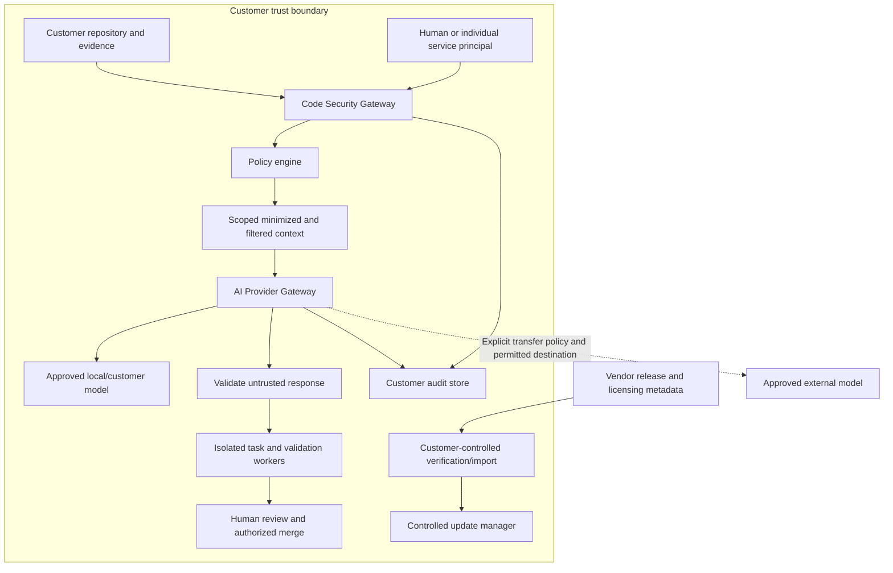

# ArchIntel enterprise security architecture

> **Phase 6 checkpoint:** Controlled source tasks and the pinned local Docker build sandbox are implemented. A controlled Java/Maven fixture passed a real offline, non-root, network-disabled build and test. Full Phase 6 acceptance remains open: customer artifact reproduction and broader characterization/security/lineage capabilities remain pending. See [verification](PHASE-6-VERIFICATION.md), [user flow](PHASE-6-USER-FLOW.md) and [developer handoff](PHASE-6-DEVELOPER-GUIDE.md). Phase 7A now supports baseline/candidate evidence comparison, captured candidate artifacts and task-linked static re-analysis with structural differences. Refactor recipes, security scanning and final acceptance remain pending. See [Phase 7 user flow](PHASE-7-USER-FLOW.md) and [developer handoff](PHASE-7-DEVELOPER-GUIDE.md).

> **Phase 5 update:** The Modernization intelligence workspace now creates immutable evidence-backed planning proposals, separate readiness/confidence, decisions, targets and dependency waves, with validation and actor-attributed review. Planning approval does not authorize code changes. See [user flow](PHASE-5-USER-FLOW.md), [developer guide](PHASE-5-DEVELOPER-GUIDE.md) and [verification](PHASE-5-VERIFICATION.md).

> **Phase 4 implementation update, 4 October 2026:** Evidence intelligence is implemented for verification: immutable version manifests/domain reviews, canonical evidence/facts/provenance, tracked guided discovery, separate persistent Neo4j projections and a bounded digital-twin workspace. PostgreSQL remains authoritative. See [verification](PHASE-4-VERIFICATION.md), [user flow](PHASE-4-USER-FLOW.md) and [developer handoff](PHASE-4-DEVELOPER-GUIDE.md). Earlier matrices remain the discovery baseline. The Phase 5 update above supersedes this historical checkpoint.

> **Phase 3 implementation update, 4 October 2026:** Runtime foundation hardening is delivered for verification: saved versioned instrumentation plans, exclusions/preview, strict optional service/artifact declaration binding, descriptor-aware coverage, ingestion quality, resource identity and lifecycle/retention recovery. See [verification](PHASE-3-VERIFICATION.md), [user flow](PHASE-3-USER-FLOW.md) and [developer handoff](PHASE-3-DEVELOPER-GUIDE.md). Real Java telemetry was validated in isolation. Broader runtime adapters/overrides remain listed in the handoff; Phase 3 results are historical; see the newer Phase 4 update above.

> **Phase 2 implementation update, 4 October 2026:** The user authorized the AI gateway phase. The local adapter, context filtering, model policy, citation validation, audit, source-range workflow and UI are implemented. Final verification is recorded in [PHASE-2-VERIFICATION.md](PHASE-2-VERIFICATION.md); see [user flow](PHASE-2-USER-FLOW.md) and [developer guide](PHASE-2-DEVELOPER-GUIDE.md). Phase 2 results are historical; see the newer Phase 3 update above.

> **4 October 2026 implementation update:** The user approved starting implementation. Phase 1 security foundation is implemented; see [verification](PHASE-1-VERIFICATION.md), [user flow](PHASE-1-USER-FLOW.md) and [developer handoff](PHASE-1-DEVELOPER-GUIDE.md). The assessment below records the pre-implementation baseline and future target. See the newer Phase 2 update above.

Planning revision 2, 3 October 2026. Proposed design pending approval; these controls are not claims of implemented security. Source: enterprise master specification, attachment `f0e63c94-fde0-416d-8e73-c41c04e98fa7`, sections 2–31, 53, 63–68 and 82–84. See [implementation roadmap](ARCHINTEL_IMPLEMENTATION_ROADMAP.md) and [current architecture](CURRENT_ARCHITECTURE.md).

## 1. Customer trust boundary

ArchIntel moves to the customer's code. Customer source, compiled artifacts, generated code, architecture/evidence graphs, database metadata, telemetry, contracts, worktrees, backups and audit records remain inside the approved customer environment by default. External transfer requires an explicit applicable customer policy and any required approval. Secret transfer to external models remains prohibited even when other content is approved.

Boundary classification is based on the actual endpoint, network route, storage and operator, not a provider name containing "local". No universal no-egress guarantee is claimed until network-denial and export tests pass for a deployment profile.

## 2. Vendor control plane

The optional vendor plane supplies release/compatibility metadata, signed update material, licensing/entitlements and explicitly opted-in safe health metadata. It does not need or request customer source, JAR/WAR, generated code, traces, architecture graphs, database metadata or secrets. Customer-initiated update checks are separate from optional telemetry. The node has no inbound vendor remote-execution requirement.

The core analysis/transformation path must not depend on vendor connectivity. Commercial control-plane availability cannot become an undocumented prerequisite for an already licensed offline workflow. Cloud-hosted profiles, if later offered, require separate disclosed boundaries rather than weakening private-deployment defaults.

## 3. Customer data plane

Customer-hosted API/UI, scanner workers, receiver, evidence services, PostgreSQL, persistent Neo4j projection, artifact storage, policy/gateways, model adapters, transformation/test sandboxes and audit run inside this boundary. Disposable scanner Neo4j stores stay distinct from the persistent knowledge graph.

Policy authorizes before data leaves; response validation follows every provider response. The diagram represents logical services, not a requirement to create a microservice for each box.

## 4. Code Security Gateway

All agent/service code and sensitive-context access passes through a backend gateway. Its enforcement extends to tool access, filesystem mounts, subprocess credentials and network policy; a frontend check or wrapper that callers can bypass is insufficient.

`SecureContextRequest` contains request/time, application/tenant, human and service identity, agent type, optional task, pinned repository/revision, requested files/entities/evidence, purpose, operation, requested model, risk and bounded metadata. The server derives/validates identities and risk from authenticated/task context rather than trusting submitted IDs. Missing purpose, ambiguous scope, unbound revision or unknown classification denies access.

Processing: authenticate -> verify tenant relationships -> permission -> repository/task scope -> minimize -> detect/filter secrets and sensitive data -> evaluate destination policy -> obtain exact approval if required -> issue a bounded context envelope -> validate downstream output -> audit outcome. Initial policy checks run before reading; final checks run on actual selected content. Denied requests also produce audit events.

## 5. AI Provider Gateway

Every model call, including the existing optional Ollama citation selector, must use one gateway. Adapters cover LOCAL_MODEL, CUSTOMER_ENTERPRISE_MODEL, PRIVATE_CLOUD_MODEL and EXTERNAL_APPROVED_MODEL. One local adapter proves the first slice; no dependency on a particular vendor is required.

The gateway accepts an authorized context envelope, verifies policy/scope/version/expiry and permitted destination, applies budgets/timeouts, invokes an approved adapter, validates output, and records a correlated audit event. Agents have no raw provider credentials or unrestricted outbound network. Provider secrets come from an approved secret source. Disable unauthorized adapters and deny unapproved redirects/endpoints; endpoint registration itself is privileged.

Current gap: `backend/app/services/assistant.py` directly calls `httpx.post` against configured `llm_url`. Its fixed citation-ID output limits claims, but it has no centralized destination policy or model-call audit. Replace that direct call during phase 2 while retaining deterministic answers and legacy-safe configuration migration.

## 6. Policy engine

`ArchIntelPolicyEngine` evaluates principal, tenant/application/repository/resource, requested operation, purpose, risk, model/destination, deployment profile, classification, task state and approval. Results: ALLOW, DENY, ALLOW_WITH_REDACTION, LOCAL_MODEL_ONLY, REQUIRE_APPROVAL, each with rule/version/reason and obligations.

Default deny; explicit denial and protected paths take precedence. REQUIRE_APPROVAL is not permission to proceed. A local model still needs source-read and scope permission. Re-evaluate on dispatch, file write, merge and deployment so a policy change cannot be bypassed with a stale authorization.

Policy revisions are schema-validated, previewable, access-controlled and audited. An approval binds the principal, action, resource/revision, destination, purpose, policy version and payload/patch digest with expiry. A changed patch or context invalidates it. Policies configure customer behavior rather than per-customer code forks.

## 7. Agent identity model

Each human, analyzer, transformation/test/validation/security/deployment agent and system service has an attributable principal. Credentials are short-lived or revocable, scoped to the service/task, never one shared unrestricted backend identity. Agents cannot grant themselves privileges or lower risk. Separate execution from approval authority where configured.

Permissions include SOURCE_READ, SOURCE_WRITE, SOURCE_TRANSFORM, EVIDENCE_READ, GRAPH_READ, RUNTIME_READ, MODEL_USE_LOCAL, MODEL_USE_EXTERNAL, GENERATE_CODE, RUN_TESTS, CREATE_BRANCH, CREATE_CHANGESET, APPROVE_CHANGE, MERGE_CHANGE, DEPLOY_TEST and DEPLOY_PRODUCTION. Role names bundle permissions; authorization evaluates the actual operation and scope.

## 8. Tenant isolation

Cross-check authenticated tenant, application, repository, task, architecture version, evidence and model configuration. Apply the same rule to direct IDs, lists, exports, graph traversal, background jobs, caches, artifacts and audits. Storage paths and graph keys are tenant-qualified. No user-supplied tenant ID can change the authenticated context.

Existing `tenant_id='local'` fields do not enforce tenancy. Migrate local records to an explicit owner workspace without exposing them to new users. Existing management routes, including token rotation and retention, need permission enforcement. Use relational integrity and query scoping, plus independent cross-tenant negative tests.

## 9. Repository scope

Bind reads/writes to the authorized repository and commit/worktree. Intersect principal permissions, approved task files, requested scope and protected paths. Resolve canonical paths and symlinks/junctions; prevent traversal, alternate roots, submodule or generated-path escapes. Do not mount unrelated repositories or host credentials into workers.

Scope may be application/module/domain/package/class/method/file/directory. Repository-wide access requires explicit justified authorization. Read, transform, branch, merge and deploy are separate permissions. Access to an interface does not imply permission to read all its implementations.

## 10. Context minimization

Use task objective and versioned twin to select relevant entities, a bounded dependency neighborhood, evidence and source ranges. Before the twin exists, enforce explicit file/range/byte limits; graph availability is not a reason to send a whole repository. Record selected and omitted resource identities, purpose and manifest hash. Cap tokens, bytes, files and retrieval depth. Context remains inside customer storage unless transfer policy permits it.

## 11. Secret detection

Use established detectors/adapters and policy matching for keys, passwords, private keys, certificates, tokens, connection strings and embedded credentials. Outcomes: block, redact or request review. Secrets must not reach external models; approval may permit a sanitized substitute, not external secret disclosure.

Fail closed when required detection cannot run. Avoid logging raw matches; retain category/location and safe identifiers. Re-scan the exact outgoing envelope and output. Detection is imperfect, so destination restrictions, least privilege and network enforcement remain necessary.

## 12. Sensitive-data handling

Classify PII, financial/health/customer/employee data, regulated identifiers and business secrets. Customer policy may allow, redact, block or constrain to a local model. Unknown content takes a conservative classification. Do not claim perfect automatic PII recognition.

The current OTLP allowlist is retained but cannot replace general source/context filtering. Do not collect request bodies/SQL values simply to generate tests. Behavioral fixtures require authorized, sanitized examples. Apply retention and redaction to prompts, responses, build logs, exception text, support bundles and model caches.

## 13. Model routing

Routing uses permitted provider/destination, classification, task/risk, deployment profile and availability. Private defaults prohibit external source/generated-source/runtime transfer; architecture metadata needs an explicitly permitted rule. External models are disabled by default. Local-model failure must not silently fall back to an external service. If no permitted model is available, use deterministic functionality or mark the AI task blocked.

## 14. Response validation

Treat model output as untrusted. Validate schema, permitted evidence references, unsupported factual claims, cross-tenant leakage, unexpected source reproduction, secrets, unsafe commands and out-of-scope edits. No free-form output is executed as a shell command. Generated patches additionally undergo allowed-path validation, compile/tests, behavioral/security/architecture validation and required performance checks. Failed validation cannot be recorded as an accepted fact or approved changeset.

## 15. Audit architecture

Record every gateway request, permitted/denied source access, model dispatch/result, policy/identity change, transformation/validation/approval/rollback, update and authorized deployment. Include correlated IDs, principal/user/agent, tenant/application/repository/task, requested/permitted/denied resource identifiers, purpose, policy revision/result, redaction categories, destination classification, timestamps and approvals. Avoid raw sensitive content.

Use append-only application permissions plus tamper-evident chaining/checkpoints or customer-approved immutable storage for enterprise retention. A normal mutable database row is not an immutability guarantee. If durable audit cannot be recorded, block privileged source/model/transformation operations; any emergency mode must be separately controlled and explicit. Test recovery and export access without weakening tenant isolation.

## 16. Git transformation isolation

Task-scoped source context and validated proposals enter an isolated checkout/worktree. Protected main/release branches and unrelated files are not writable to agents. Sandboxes restrict CPU/memory/time/disk/process/network and secrets; Maven/Gradle plugins and tests execute untrusted code. Validate exact base/head/patch digests before authorized merge. Record failed-worktree cleanup and rollback. Data migration requires its own tested recovery plan; a Git revert is insufficient.

## 17. Update security

`ArchIntelUpdateManager` accepts connected releases or manually imported offline bundles. Release pipeline: build -> test -> security scan -> SBOM -> manifest/artifact hashes -> digital signature -> publish. Customer flow: inspect/approve -> retrieve/import -> verify pinned trust material, signatures, hashes, version and compatibility -> preflight/backup -> apply DB/graph/config migrations -> health and smoke checks -> accept or controlled recovery.

Bundle contents: images/packages, DB/graph/config migrations, release manifest, SBOM, checksums, signatures, notes and compatibility metadata. Validate before extraction/execution, enforce archive/resource limits and reject unsigned/tampered/untrusted/incompatible bundles. Define key rotation/revocation and anti-replay/downgrade policy. An authorized rollback is a specific signed recovery action, not a generic downgrade bypass.

Record schema compatibility and backup/restore requirements. Do not promise arbitrary reverse migrations: block upgrades lacking a supported rollback/recovery path and demonstrate recovery on test data. SBOM records contents; it is not proof of vulnerability freedom. Vendor signing keys never ship in customer bundles.

## 18. Offline / air-gapped operation

Profiles: CUSTOMER_VPC and ON_PREMISES first; AIR_GAPPED designed in from the start and fully validated in phase 9; ARCHINTEL_CLOUD later and explicitly opt-in. Use local models, databases, graphs, documentation, required containers/packages, build dependencies, trust material and signed licenses. Network-isolated scans alone do not prove offline install, customer builds or updates work.

Signed license files carry customer/deployment identity, edition/features, expiration/limits and local verification material. Define offline expiry/clock handling, renewal and data-export/recovery behavior without hidden phone-home. Licensing is separate from billing.

Telemetry modes: DISABLED (default private/air-gap), SECURITY_SAFE (strict allowlisted metadata), CUSTOM (reviewed schema). No hidden telemetry. Customer-reviewed support bundles exclude source/generated code/secrets/payloads/database contents/architecture-sensitive data by default; creation does not authorize upload. Validate offline install/start/analysis/model/build/validation/license/update/rollback/documentation with outbound traffic denied and monitored.

## 19. Threat boundaries and controls

| Boundary / threat | Planned enforcement and evidence |
|---|---|
| Browser or forged principal -> management API | Authentication, scoped permissions and existing origin/host defenses; cross-role/tenant tests |
| Agent -> arbitrary source or graph | Gateway, bounded queries and filesystem/network isolation; forbidden read/write/escape tests |
| Repository/trace/prompt -> model instructions | Treat content as data, bounded tools/context, output validation; injection tests |
| Customer plane -> external provider/vendor | Destination policy before dispatch plus egress rules; network-capture denial tests |
| Model patch/build -> customer host | Untrusted-output checks and execution sandbox; protected path/command/plugin tests |
| Approver -> stale or different changeset | Exact patch/policy/resource binding; concurrent-change tests |
| Release channel -> executable update | Trusted signatures/digests/compatibility and restore gates; tamper/rollback tests |
| Diagnostics/audit -> sensitive-data leak | Metadata minimization, redaction, scoped review/export; seeded canary tests |
| Storage/backups -> unauthorized disclosure | Customer-approved encryption/key management, restricted access, encrypted backups and restore exercises |

Credentials move from the current local `.env` deployment practice to customer secret-manager references, OS credential stores or protected mounted secrets. Add migration/rotation guidance; do not claim existing settings implement encrypted storage. TLS termination, service identity, key ownership and backup encryption are explicit deployment acceptance items. Future compliance evidence may support customer assessments; no SOC 2/ISO certification is claimed.

## 20. Security test strategy

Mandatory acceptance tests from enterprise section 82:

1. Tenant A cannot read Tenant B source, evidence, graphs, outputs or audit.
2. No SOURCE_READ means no source access; Payment-only scope cannot read unrelated Customer code.
3. External destinations receive no context when policy denies; external use requires explicit permission; permitted local routing succeeds.
4. Secret-containing context is blocked/redacted; sensitive and unknown content follows policy; failed scanners do not permit dispatch.
5. Every source/model request, including denial, is durably audited without leaking content.
6. Response validation rejects forged evidence, out-of-scope patches, unsafe commands and injected instructions.
7. Generated code cannot modify protected branches; high-risk changes and production deployment require their distinct authorizations.
8. Unsigned, tampered, incompatible, revoked/untrusted or replayed update bundles are rejected; approved upgrade/rollback preserves customer state.
9. Offline operation succeeds without vendor connectivity; denied-egress capture shows no hidden dependencies or telemetry.
10. Policy changes, credential revocation, stale approvals, audit failure, sandbox escape attempts and backup recovery are exercised.

Security tests are part of phase completion, alongside preserved static/runtime regressions and real integrations. Approval of this plan authorizes the next bounded implementation milestone, not data export, production deployment or destructive migration. Implementation has not started in this planning revision.
