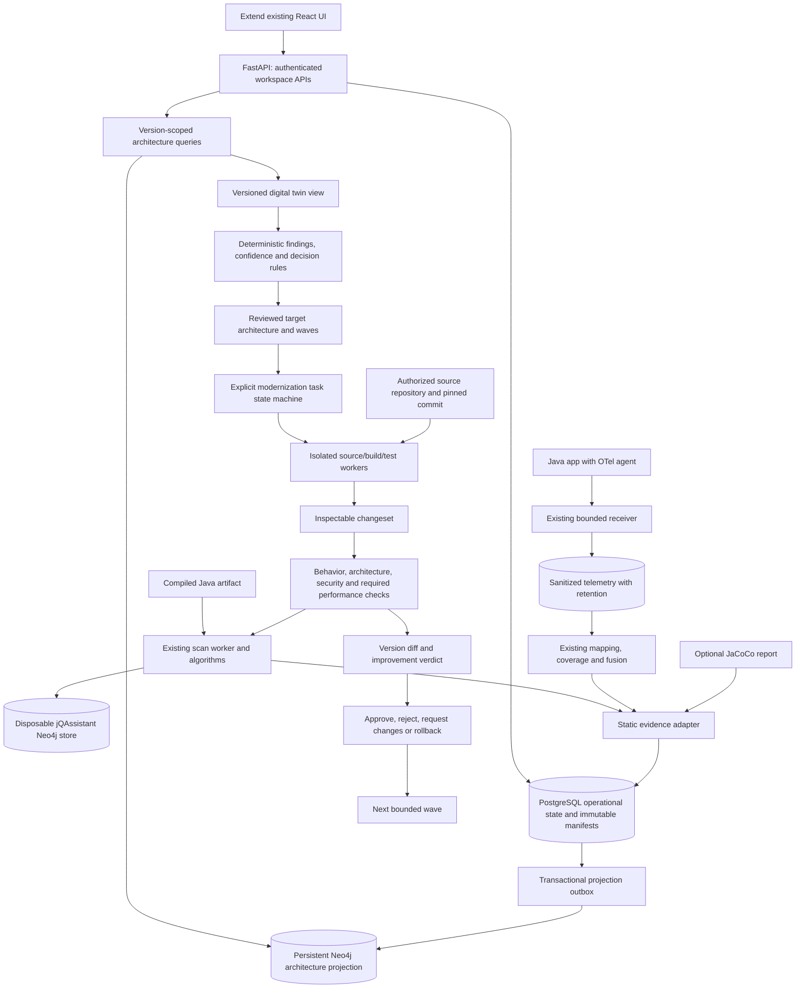
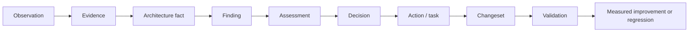

# ArchIntel target architecture

> **Phase 6 checkpoint:** Controlled source tasks and the pinned local Docker build sandbox are implemented. A controlled Java/Maven fixture passed a real offline, non-root, network-disabled build and test. Full Phase 6 acceptance remains open: customer artifact reproduction and broader characterization/security/lineage capabilities remain pending. See [verification](PHASE-6-VERIFICATION.md), [user flow](PHASE-6-USER-FLOW.md) and [developer handoff](PHASE-6-DEVELOPER-GUIDE.md). Phase 7A now supports baseline/candidate evidence comparison, captured candidate artifacts and task-linked static re-analysis with structural differences. Refactor recipes, security scanning and final acceptance remain pending. See [Phase 7 user flow](PHASE-7-USER-FLOW.md) and [developer handoff](PHASE-7-DEVELOPER-GUIDE.md).

> **Phase 5 update:** The Modernization intelligence workspace now creates immutable evidence-backed planning proposals, separate readiness/confidence, decisions, targets and dependency waves, with validation and actor-attributed review. Planning approval does not authorize code changes. See [user flow](PHASE-5-USER-FLOW.md), [developer guide](PHASE-5-DEVELOPER-GUIDE.md) and [verification](PHASE-5-VERIFICATION.md).

> **Phase 4 implementation update, 4 October 2026:** Evidence intelligence is implemented for verification: immutable version manifests/domain reviews, canonical evidence/facts/provenance, tracked guided discovery, separate persistent Neo4j projections and a bounded digital-twin workspace. PostgreSQL remains authoritative. See [verification](PHASE-4-VERIFICATION.md), [user flow](PHASE-4-USER-FLOW.md) and [developer handoff](PHASE-4-DEVELOPER-GUIDE.md). Earlier matrices remain the discovery baseline. The Phase 5 update above supersedes this historical checkpoint.

> **Phase 3 implementation update, 4 October 2026:** Runtime foundation hardening is delivered for verification: saved versioned instrumentation plans, exclusions/preview, strict optional service/artifact declaration binding, descriptor-aware coverage, ingestion quality, resource identity and lifecycle/retention recovery. See [verification](PHASE-3-VERIFICATION.md), [user flow](PHASE-3-USER-FLOW.md) and [developer handoff](PHASE-3-DEVELOPER-GUIDE.md). Real Java telemetry was validated in isolation. Broader runtime adapters/overrides remain listed in the handoff; Phase 3 results are historical; see the newer Phase 4 update above.

> **Phase 2 implementation update, 4 October 2026:** The user authorized the AI gateway phase. The local adapter, context filtering, model policy, citation validation, audit, source-range workflow and UI are implemented. Final verification is recorded in [PHASE-2-VERIFICATION.md](PHASE-2-VERIFICATION.md); see [user flow](PHASE-2-USER-FLOW.md) and [developer guide](PHASE-2-DEVELOPER-GUIDE.md). Phase 2 results are historical; see the newer Phase 3 update above.

> **4 October 2026 implementation update:** The user approved starting implementation. Phase 1 security foundation is implemented; see [verification](PHASE-1-VERIFICATION.md), [user flow](PHASE-1-USER-FLOW.md) and [developer handoff](PHASE-1-DEVELOPER-GUIDE.md). The assessment below records the pre-implementation baseline and future target. See the newer Phase 2 update above.

Proposal revision 2, 3 October 2026, pending user approval. This is a design, not a claim of implemented functionality. It extends the [current architecture](CURRENT_ARCHITECTURE.md), follows the revised [roadmap](ARCHINTEL_IMPLEMENTATION_ROADMAP.md), and incorporates the [enterprise security architecture](ARCHINTEL_SECURITY_ARCHITECTURE.md). The enterprise master specification (`f0e63c94-fde0-416d-8e73-c41c04e98fa7`) governs customer-hosted boundaries, gateways and phase order; its section 84 and the user's request prohibit implementation before approval. Earlier functional design remains applicable where compatible.

## 1. Architecture decision

Evolve the existing FastAPI/React application as a modular application with separately isolated execution workers. Keep PostgreSQL for operational records and authoritative provenance/version manifests. Keep jQAssistant's embedded Neo4j scan stores disposable. Add a separate persistent Neo4j architecture graph as a rebuildable, version-scoped projection of durable records. Do not introduce a second static scanner or store operational task state only in Neo4j.

The initial product focus is Java modernization supervised by a human: one evidence-backed, reversible boundary refactor with behavior checks and re-analysis. Service extraction and data migration follow that proof. A modular monolith is a valid target; microservices are not the default answer.

## 2. Proposed topology

The graph records knowledge. Deterministic algorithms produce measurements. Bounded agents propose interpretations or changes. Validation and approval services enforce publication/execution policy. Model output never directly mutates facts, scores, protected branches, or production resources.

The topology above describes components inside the customer data plane. All agent source/evidence context requests additionally pass through the Code Security Gateway and policy engine; all model calls pass through the AI Provider Gateway. Enforcement includes worker credentials, filesystem mounts and network rules. The separate vendor control plane only supplies approved licensing/release/compatibility metadata and optional safe telemetry. It never requires customer source, graphs, traces or generated code. See the security architecture for the authoritative trust-boundary diagram and controls.

## 3. Boundaries and integration points

Names below are proposed service boundaries; do not create empty module trees merely to match this list.

| Boundary | Responsibility | Existing integration |
|---|---|---|
| Platform access | Accounts, workspace membership, roles, authorization, audit, operational jobs | `main.py`, `api.session`, models/Alembic, launch/deployment scripts |
| Static analysis | Preserve archive -> scan -> normalized snapshot workflow | `ingestion.py`, `scanner.py`, exporter, `engine.py`, `pipeline.py` |
| Runtime observation | Session lifecycle, instrumentation plan, ingestion, mapping, coverage, aggregation | `runtime/routes.py`, `services/runtime/*` |
| Evidence/version service | Idempotent evidence ingestion, facts, provenance, source identities, version manifests | Adapters over completed `AnalysisRun.result` and runtime results; no mutation of originals |
| Architecture queries/twin | Bounded graph traversal, selected-version model, provenance navigation | New graph repository behind API services; preserve existing graph APIs |
| Intelligence | Findings, guided discovery, independent readiness/confidence, validation, decisions | Existing issues/metrics/modernization/intelligence algorithms |
| Planning | Reviewed domain revision, target architecture, contracts, waves, prerequisites | Current domain and modernization UI/data, new versioned records |
| Transformation | Task policy, isolated checkout, bounded edit recipes, changesets | New source connector and workers; do not execute source builds inside API/scanner process |
| Validation | Baseline/build/tests/contracts/security/performance/re-analysis/diff | Existing scanner and real integration fixtures plus new result adapters |
| Delivery/orchestration | Generated service packages/Compose, future CI adapters and supervised task progression | Existing deploy files are examples for ArchIntel itself, not a generator |
| Assistant | Intent/entity resolution, bounded evidence retrieval, proposal, claim validation, fallback | Existing deterministic assistant and optional citation-selection provider |

## 4. Storage and consistency

### PostgreSQL

Authoritative operational state: users/workspaces/memberships, jobs and leases, repositories/source revisions/build records, runtime sessions, domain revisions, architecture-version manifests, evidence/facts/findings, assessments/decisions/plans/waves, tasks, contracts, changesets, validations, approvals, rollback records, audit, and graph-projection outbox.

Use additive Alembic migrations. Preserve current IDs and `analysis_runs.result`. A legacy adapter creates new records from old snapshots without rewriting them. Record adapter/schema/algorithm versions. Existing `tenant_id=local` data needs explicit assignment to the bootstrap workspace; absence of ownership is not permission to expose it to every user.

Every child reference must enforce workspace, application, and compatible version identity. Scope reads, lists, exports, mutations, graph queries, background jobs, span access, and audit. Returning 404 for cross-workspace objects avoids disclosing their existence. Relational constraints and authorization tests must cover indirect references, not only top-level IDs.

### Neo4j

Use a separate persistent database/service for architecture knowledge. Never point it at per-job scanner directories. Materialize graph data through versioned, idempotent projection jobs fed by a transactional outbox. The operational transaction commits once in PostgreSQL; projection retries may replay safely.

Each graph identity is qualified by workspace, application, architecture version, entity kind, and stable local identity. Add appropriate uniqueness constraints/indexes. Relationships cannot cross these scopes except explicit authorized lineage edges. APIs use parameterized, bounded query templates; users and LLMs do not send arbitrary executable Cypher.

Version projection states: PENDING, BUILDING, READY, FAILED, with input/content hashes. A graph-dependent decision requires the exact version to be READY. Existing static/runtime pages continue to operate if the graph service is unavailable. A stale graph must not silently answer as the newest version. A rebuild must reproduce the same fact/evidence IDs from manifests.

### Artifact storage

Start with the existing owned filesystem abstraction, then allow object storage if scale requires it. Store content hashes, ownership, retention class, and access policy in PostgreSQL. Separate short-lived telemetry from longer-lived sanitized aggregate evidence and review history. Preserve enough non-sensitive supporting evidence to audit accepted decisions after raw-span expiry; otherwise mark the support expired or incomplete.

## 5. Core contracts

All new records carry schema version, workspace/application scope, timestamps, producer version, and stable ID. These are proposed contracts, not existing tables.

| Record | Required content and invariants |
|---|---|
| `SourceRevision` / `BuildRecord` | Repository identity, pinned commit, checkout hash, trusted build recipe/toolchain, produced artifact SHA-256, logs/status; proves which source produced the analyzed artifact |
| `Evidence` | Master-spec source types; collector and source reference; entity identities; structured observation/value/unit; observation time; mapping confidence; baseline/session selection; provenance hash; sensitivity/retention; original observation retained |
| `ArchitectureFact` | Typed subject/predicate/object; supporting/contradicting evidence IDs; classification; validity scope; derivation rule version; no unsupported dependencies |
| `Finding` | Rule ID/version, affected entities, severity, facts/evidence, rationale, investigation, confidence, validator state; static and runtime taxonomy coexist |
| `ArchitectureVersion` | Parent lineage, static run, source/build identity, sorted selected session IDs, observation window, coverage import IDs, domain revision, algorithm/config hashes, fact/evidence manifest, projection status |
| `DomainRevision` | Reviewed membership/name changes, actor/reason/evidence, original version, previewed effects; stable business-domain identity separated from membership snapshot hash |
| `RuntimeExplorationRecommendation` | Target/type, priority, reason, evidence, suggested scenario explicitly labeled inference, status and observation follow-up |
| `Assessment` | Structural/runtime/combined scores, component definitions/weights, separate confidence vector, unknowns, strengths/risks/blockers, data scope |
| `ModernizationDecision` | Strategy, evidence/finding IDs, blockers, prerequisites, actions, confidence, validation state, policy version; may recommend more observation or retaining a modular monolith |
| `TargetArchitecture` / `Wave` | Reviewed modules/services, ownership/interfaces/data contracts, dependency-aware prerequisites, coupled groups, difficulty and expected impact |
| `BehavioralContract` | Scenario, safe input fixtures, preconditions, output/status/error and permitted database/event/external-effect assertions, source/evidence, confidence, known gaps |
| `ModernizationTask` | Master task fields, pinned architecture/source version, objective/type/risk, allowed/protected files, dependencies/prerequisites, contracts, expected measurable change, validation requirements |
| `ModernizationChangeSet` | Task, branch/base/head commits, exact patch and file/dependency/API/data/config changes, generated artifacts/tests, rationale/evidence, validation and approval state |
| `ValidationResult` | Check/tool/version, inputs and hashes, exit/result, bounded artifacts, comparison tolerances, NOT_RUN/INCONCLUSIVE distinct from PASS; failures never converted to success |
| `Approval` / `AuditEvent` | Actor, action, exact task/changeset hash/version, policy, timestamp/reason, append-only history, correlation ID; any changed patch invalidates prior approval |
| `GraphDiff` / `ImprovementVerdict` | Compatible versions, entity correspondence, structural and observation deltas, changed blockers/scores/confidence, behavior verdict, explicit limitations |

For method identity use owner plus JVM descriptor where available; names alone cannot resolve overloads. For database identity require system/instance/namespace/resource when making shared-resource conclusions. Class rename correspondence requires source/recipe/user evidence; string similarity is not architecture truth.

## 6. Evidence and digital twin semantics

The digital twin is a version-scoped machine-readable query/view over facts, findings, observations, declared intent, and modernization state. It is not a second competing source of truth. Unknown API contracts, transactions, ownership, security boundaries, or business flows remain unknown until supported.

Suggested node labels: Application, AnalysisVersion, RuntimeSession, Domain, Package, Class, Method, EntryPoint, Repository, DataResource, Database, RuntimeFlow, Dependency, Cycle, Evidence, ArchitectureFact, Finding, ModernizationAssessment, ModernizationDecision, ModernizationAction, ModernizationWave, BehavioralContract, ModernizationTask, ChangeSet, ValidationResult, ArchitectureVersion.

Relationships include CONTAINS, BELONGS_TO, DEPENDS_ON, CALLS, ACCESSES, READS_FROM, WRITES_TO, PARTICIPATES_IN, OBSERVED_IN, SUPPORTED_BY, CONTRADICTED_BY, AFFECTS, CONTRIBUTES_TO, BLOCKED_BY, REQUIRES, PRECEDES, TRANSFORMED_BY, VALIDATED_BY, EVOLVED_TO. Materialize labels only when a delivered feature produces valid records; this list is not a scaffolding checklist.

Required traceability:

Critical fusion invariant remains: A->B and B->D seen statically and dynamically are corroborated; A->C only static stays STATIC_ONLY; X->B only observed stays DYNAMIC_ONLY. A->C never automatically becomes unused. Repeated parent-child nesting does not prove an uninstrumented intermediate call chain.

## 7. Readiness, confidence, and conclusion validation

Keep existing structural score versions readable. Runtime dimensions extend the present deterministic functions, with measured/calibrated rule changes versioned separately. No model-generated numerical scores.

Confidence is independent of readiness. Proposed evidence-quality dimensions: class/method/entry/dependency/domain observation, mapping ambiguity, missing parents/dropped spans, scenario representativeness, recency, sampling, data identity completeness, and behavioral protection. Display unavailable dimensions rather than replacing them with zero. Calibration requires reviewed examples; confidence is not a probability merely because it is a decimal.

Publication validator statuses follow the master specification: VALIDATED, VALIDATED_WITH_LIMITATIONS, INSUFFICIENT_EVIDENCE, CONFLICTING_EVIDENCE, REQUIRES_MORE_RUNTIME_OBSERVATION. Rule-based validation can operate before any LLM. High readiness with poor evidence should produce an observation/review prerequisite, not automatic extraction.

Domain edits trigger a new revision, recalculated projections/assessments, and explicit invalidation of dependent plans. Original findings and previous decisions remain accessible against their original version.

## 8. Safe transformation and validation

1. Connect an authorized source repository and pin a commit. Do not assume uploaded bytecode is editable source. Build it in an isolated worker and match the analyzed artifact or create a new, explicitly linked baseline.
2. Inventory existing tests/contracts and demonstrate the unchanged baseline passes the selected build/behavior checks. A failing baseline blocks automated attribution of failures to a new patch.
3. Create one bounded task and reviewed expected change. Fix allowed/protected paths and dependency/network/secret policy.
4. Create a dedicated branch/worktree of the customer repository, outside protected working copies. Verify resolved paths and symlinks. The current ArchIntel workspace lacks Git metadata; do not initialize or rewrite it as part of discovery.
5. Apply a small recipe/AST-aware edit with an inspectable patch. The first candidate is boundary/interface introduction or a demonstrable cycle-breaking refactor, selected from actual evidence after source review. Do not presume PetClinic has a suitable removable cycle.
6. Compile, run existing and characterization tests, compare declared behavior, run security checks, and run performance checks where the task demands them. Generated tests are not proof of complete business truth.
7. Reuse the existing scanner on the new compiled artifact, collect comparable runtime evidence where required, create a new version, and calculate graph diff.
8. Evaluate the task's predeclared impact: for example a target cycle removed with no forbidden new dependency, contracts passing, and no new blocker. Readiness increase alone does not establish improvement.
9. Present before/after evidence and patch for approval. Only the exact validated changeset can be approved/merged. Never write to protected main directly.
10. On failure preserve evidence/logs and discard or revert the isolated task changes through recorded Git operations. After merge, rollback requires a reviewed revert; after data migration, Git rollback is insufficient and a separate tested data recovery plan is mandatory.

Task state machine uses explicit conditional transitions and durable worker leases. Core path: PLANNED -> READY -> GENERATING -> BUILDING -> TESTING -> BEHAVIORAL_VALIDATION -> ARCHITECTURE_VALIDATION -> SECURITY_VALIDATION -> AWAITING_APPROVAL -> APPROVED -> MERGED. Required performance checks attach as gates before approval. Failure records the failed gate then enters rollback/replan policy. PAUSED/BLOCKED are explicit states/reasons, not implied by chat text. Crash recovery must not repeat a merge, deployment, or migration.

Build workers need OS/container isolation, CPU/memory/time/disk/process limits, controlled egress, scoped credentials, and cleanup. Downloads/build plugins are untrusted inputs. The API and graph agent must never interpolate user/model output into shell commands.

## 9. Graph-grounded assistant and specialized analysis

Keep the current deterministic answer path available. Add typed intent/entity resolution and bounded graph traversal for the selected version. A provider receives only relevant, sanitized context and permitted evidence IDs. Separate observed facts, interpretation, recommendations, limitations, and sources.

Structural/runtime/data/coverage/domain/modernization analyzers should first be bounded services around existing algorithms. A validation component independently checks claims and missing/conflicting evidence. No autonomous agent swarm is needed for the first vertical slice.

Any generative extension needs provider opt-in, data-use controls, prompt-injection evaluation against source/trace content, citation support checks, unsupported-claim rejection, budgets/timeouts, and deterministic fallback. Model prose cannot change immutable evidence or the rule engine's metrics. Store the proposal and validation result separately from accepted architectural facts.

Enterprise addition: even the existing optional Ollama citation-selection call must move behind the AI Provider Gateway. A "local" label does not prove endpoint residency. Each analyzer/agent has its own scoped identity; requests include purpose and exact authorized source/evidence scope. Customer policy determines routing, external usage defaults off, and no provider outage can silently trigger external fallback. Source transformation uses only gateway-authorized, minimized and filtered context; all requests and model invocations are audited.

## 10. UI and API evolution

Preserve existing navigation and views; add functionality when backend contracts exist. Proposed API families are additive, not already implemented: `/architecture-versions`, `/evidence`, `/facts`, `/findings`, `/domain-revisions`, `/exploration-recommendations`, `/decisions`, `/target-architectures`, `/waves`, `/source-revisions`, `/behavioral-contracts`, `/modernization-tasks`, `/changesets`, `/validations`, `/approvals`, `/architecture-diffs`, `/audit` under the existing versioned API convention.

Every new list needs bounded pagination/filtering and scope checks. Writes need conflict detection/idempotency. Existing endpoints should either retain their schemas or expose explicit version adapters. Long operations return jobs and status, not blocking request execution.

UI progression: secure onboarding and retry diagnostics; guided runtime discovery; version selection and evidence traversal; reviewed target architecture/waves; task/changeset/validation review; before/after progress; finally the supervised control center. Display evidence expiry and selected session/version scope. Distinguish plan execution percentage from runtime coverage or modernization readiness.

## 11. Deployment, privacy, and operational gates

Initial enterprise targets: CUSTOMER_VPC and ON_PREMISES, using customer-hosted PostgreSQL, separate graph projection service, bounded workers and Compose-based validation. AIR_GAPPED compatibility constrains design immediately; complete offline acceptance follows in phase 9. ARCHINTEL_CLOUD and Kubernetes/provider breadth are later options. Existing localhost mode remains a development path. Authenticated permission-backed workspace access, individual service identities, policy and audit are prerequisites for shared exposure. TLS, customer-approved storage/backup encryption and keys, secret-manager references, tested restore, migrations, readiness and diagnostics form the release gate.

Raw request/response bodies, tokens, cookies, database credentials, SQL values, and PII are not default telemetry. Behavioral fixtures must be authored or sanitized under explicit scope rather than harvested indiscriminately from production. Error output and generated reports also need secret filtering.

Measure receiver throughput, aggregation latency, drops, graph-query latency, worker recovery, and target-application overhead. Safety limits do not substitute for load evidence. Add incremental/materialized aggregates only when they preserve current counting semantics and are benchmarked.

## 12. Deliberate deferrals and decisions

Defer multi-language modernization, all cloud providers, Kubernetes/Helm/Terraform, Jira/IDE plugins, billing/marketplace, autonomous production deployment, and broad multi-agent orchestration. Introduce CI/provider adapters only after a validated Java slice exists.

Resolved design choices: keep current static engine; separate disposable scanner graph from persistent knowledge graph; keep operational truth relational; version every accepted architecture context; use rule-based scores and independent confidence; require source/build binding before transformation; validate before approval.

Future milestone decisions: identity provider versus local accounts for the intended deployment; supported source/build toolchains and isolated executor; Neo4j deployment/licensing/version compatibility; representative behavioral scenarios; accepted comparison tolerances; retention and audit policy. None prevent producing this discovery assessment. They do prevent pretending an enterprise deployment or autonomous transformation is already complete.

Implementation remains stopped at the discovery gate until the user instructs the next milestone.

## 13. Enterprise additions and sequence changes

Mandatory new boundaries: Code Security Gateway, SecureContextRequest, Policy Engine, AI Provider Gateway, secret/sensitive-data filters, output validation, and durable access audit. Security UI exposes requested/permitted/denied scope, model/destination, redactions, approvals, policy and update history without unnecessarily logging content.

CustomerProfile versions configure analysis/runtime/security/AI/modernization/Git/retention/deployment/integrations through adapters and feature flags, not customer forks. Telemetry supports DISABLED, SECURITY_SAFE and reviewed CUSTOM modes; private/offline defaults are disabled. Support bundles are locally generated, sanitized and customer-reviewed before export.

Product updates are distinct from generated-application deployment. ArchIntelUpdateManager verifies signed release manifests, artifact hashes, compatibility and supported recovery, then uses customer approval, backup, migrations, health checks and controlled rollback. Offline bundles include images/packages, DB/graph/config migrations, SBOM, notes, signatures and compatibility metadata. Offline signed licenses are verified locally with no permanent vendor connectivity. No automatic production deployment or compliance certification is implied.

Revised enterprise phases: 0 plan approval; 1 security foundation; 2 AI gateway; 3 existing runtime hardening; 4 evidence/twin; 5 modernization intelligence; 6 safe transformation; 7 incremental factory; 8 continuous modernization; 9 private deployment/updates/offline acceptance. Minimal versioning/diff arrives before accepting the first phase-7A refactor. All detailed dependencies and gates are in the revised roadmap.
