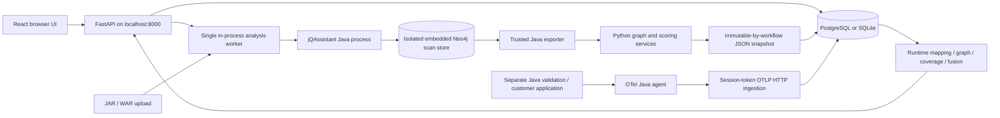

# ArchIntel current architecture

> **Phase 6 checkpoint:** Controlled source tasks and the pinned local Docker build sandbox are implemented. A controlled Java/Maven fixture passed a real offline, non-root, network-disabled build and test. Full Phase 6 acceptance remains open: customer artifact reproduction and broader characterization/security/lineage capabilities remain pending. See [verification](PHASE-6-VERIFICATION.md), [user flow](PHASE-6-USER-FLOW.md) and [developer handoff](PHASE-6-DEVELOPER-GUIDE.md). Phase 7A now supports baseline/candidate evidence comparison, captured candidate artifacts and task-linked static re-analysis with structural differences. Refactor recipes, security scanning and final acceptance remain pending. See [Phase 7 user flow](PHASE-7-USER-FLOW.md) and [developer handoff](PHASE-7-DEVELOPER-GUIDE.md).

> **Phase 5 update:** The Modernization intelligence workspace now creates immutable evidence-backed planning proposals, separate readiness/confidence, decisions, targets and dependency waves, with validation and actor-attributed review. Planning approval does not authorize code changes. See [user flow](PHASE-5-USER-FLOW.md), [developer guide](PHASE-5-DEVELOPER-GUIDE.md) and [verification](PHASE-5-VERIFICATION.md).

> **Phase 4 implementation update, 4 October 2026:** Evidence intelligence is implemented for verification: immutable version manifests/domain reviews, canonical evidence/facts/provenance, tracked guided discovery, separate persistent Neo4j projections and a bounded digital-twin workspace. PostgreSQL remains authoritative. See [verification](PHASE-4-VERIFICATION.md), [user flow](PHASE-4-USER-FLOW.md) and [developer handoff](PHASE-4-DEVELOPER-GUIDE.md). Earlier matrices remain the discovery baseline. The Phase 5 update above supersedes this historical checkpoint.

> **Phase 3 implementation update, 4 October 2026:** Runtime foundation hardening is delivered for verification: saved versioned instrumentation plans, exclusions/preview, strict optional service/artifact declaration binding, descriptor-aware coverage, ingestion quality, resource identity and lifecycle/retention recovery. See [verification](PHASE-3-VERIFICATION.md), [user flow](PHASE-3-USER-FLOW.md) and [developer handoff](PHASE-3-DEVELOPER-GUIDE.md). Real Java telemetry was validated in isolation. Broader runtime adapters/overrides remain listed in the handoff; Phase 3 results are historical; see the newer Phase 4 update above.

> **Phase 2 implementation update, 4 October 2026:** The user authorized the AI gateway phase. The local adapter, context filtering, model policy, citation validation, audit, source-range workflow and UI are implemented. Final verification is recorded in [PHASE-2-VERIFICATION.md](PHASE-2-VERIFICATION.md); see [user flow](PHASE-2-USER-FLOW.md) and [developer guide](PHASE-2-DEVELOPER-GUIDE.md). Phase 2 results are historical; see the newer Phase 3 update above.

> **4 October 2026 implementation update:** The user approved starting implementation. Phase 1 security foundation is implemented; see [verification](PHASE-1-VERIFICATION.md), [user flow](PHASE-1-USER-FLOW.md) and [developer handoff](PHASE-1-DEVELOPER-GUIDE.md). The assessment below records the pre-implementation baseline and future target. See the newer Phase 2 update above.

Repository discovery: 3 October 2026. Original assessment scope followed section 91 of the first complete master specification; the enterprise revision now follows section 84 of the newer specification. No feature implementation is authorized by this planning milestone.

Planning revision 2 adds the enterprise specification (`f0e63c94-fde0-416d-8e73-c41c04e98fa7`) and [security architecture](ARCHINTEL_SECURITY_ARCHITECTURE.md). Existing behavior and the recorded test baseline below are unchanged. No new test execution or enterprise controls are claimed by this documentation update; implementation awaits approval.

## 1. Finding

ArchIntel is a working local Java architecture-analysis prototype. It combines real bytecode scanning, deterministic structural analysis, real OTLP runtime ingestion, conservative static/runtime mapping, observation coverage, additive graph fusion, and evidence-linked heuristic assessments. It is not yet an enterprise modernization platform, persistent architecture knowledge graph, or code-transformation factory.

The existing engines should be preserved. The shortest modernization path extends their outputs with durable provenance, architecture versions, reviewed decisions, source/build identity, an isolated transformation task, behavioral validation, and before/after comparison.

Companion documents: [target architecture](ARCHINTEL_TARGET_ARCHITECTURE.md), [complete capability roadmap](ARCHINTEL_IMPLEMENTATION_ROADMAP.md). The new master specification supersedes the earlier plan's priorities; completed work remains valid. Historical documents such as `phase-0-report.md` describe earlier checkpoints, not the current implementation.

## 2. Assessment scope and method

Inspected first-party backend models, migrations, routes, configuration, security, analysis/runtime services, Java exporter, frontend views and client code, dependency manifests/locks, infrastructure, setup/launch/validation scripts, synthetic Java samples, tests, and delivery reports. Generated dependencies, binaries, telemetry, database files, and cached vendor application source were treated as artifacts rather than ArchIntel product code. Secrets from `.env` were not included in this assessment.

No project-owned `AGENTS.md` was found. The workspace has no Git repository: `git rev-parse --show-toplevel` fails. Git is installed; Docker is not available on PATH. A `jqassistant/store` directory exists, but the running adapter explicitly creates stores under each analysis job, so that directory is not evidence of a persistent product knowledge graph.

| Milestone item | Scope |
|---|---|
| Objective | Establish source-backed current/target architecture and dependency-ordered roadmap |
| Reuse | Existing code, tests, historical validation evidence, dependency manifests |
| Files created | This file, `ARCHINTEL_TARGET_ARCHITECTURE.md`, `ARCHINTEL_IMPLEMENTATION_ROADMAP.md` |
| Existing source files modified | None |
| Database / Neo4j / API / frontend changes | None; production frontend build regenerates existing build output only |
| Security / performance impact | No runtime behavior change; assessment identifies gaps |
| Tests | Existing backend, real scanner integration, frontend tests, and production build |
| Risks | Historical results mistaken for fresh runs; source existence mistaken for production completeness |

## 3. Runtime topology

There is no live Bolt-backed application knowledge service in the request path. A Neo4j Python driver and connection settings exist, but their presence does not establish persistent graph usage. jQAssistant and the Java exporter use embedded Neo4j. The resulting normalized architecture lives in relational JSON snapshots; temporary scan stores are cleaned up after attempts.

## 4. Technology and repository map

| Area | Current implementation | Source |
|---|---|---|
| API | Python 3.12 workspace runtime; FastAPI, Uvicorn, Pydantic | `backend/app/main.py`, `config.py`, `schemas.py` |
| Relational persistence | SQLAlchemy 2, psycopg, Alembic; PostgreSQL local deployment; SQLite test/local fallback | `backend/app/db/`, `models.py`, `backend/alembic/` |
| Static scanner | jQAssistant 2.7.0, bundled Neo4j 5.26.5; Java 21 workspace JDK | `services/scanner.py`, `scanner-java/ExportGraph.java` |
| Algorithms | NetworkX, seeded python-louvain, explicit Python rules | `backend/app/services/` |
| Telemetry | OTel Java agent; OTLP HTTP protobuf/JSON; protobuf package pinned in requirements | `backend/app/services/runtime/`, `backend/app/runtime/` |
| Frontend | React 19, TypeScript, Vite, TanStack Query, Cytoscape, Tailwind/CSS, Lucide | `frontend/src/`, `frontend/package.json` |
| Testing | pytest/TestClient, Vitest/Testing Library, Playwright installed Chrome | `backend/tests/`, `frontend/src/*.test.tsx`, `frontend/e2e/` |
| Build/setup | Python requirements lock; npm locks; PowerShell; trusted Java helper compilation | `scripts/setup.ps1`, `bootstrap.ps1`, `build_exporter.ps1` |
| Deployment | Local CMD/PowerShell launchers; Docker/Compose definitions | `Start-ArchIntel.cmd`, `scripts/start.ps1`, `infra/docker/Dockerfile`, `docker-compose.yml` |
| Reference material | User/developer manuals, previous measurements and screenshots | `docs/` |

Installed versions and checked-in constraints must not be confused with a broad support matrix. Bootstrap downloads the latest Java 21 distribution from its configured endpoint; that input is not fully reproducible despite pinned scanner/Python versions. Compose specifies PostgreSQL 16, whereas the embedded local PostgreSQL package supplies a different version. Both deployment paths require independent validation.

## 5. Backend and relational model

`create_app()` upgrades Alembic, builds a SQLAlchemy session factory, starts `AnalysisWorker`, recovers persisted pending analyses, and starts an asynchronous retention sweep. API routers are mounted before the built frontend. The worker and runtime lock are process-local.

| Table | Purpose / relationships | Limits |
|---|---|---|
| `projects` | Workspace-style grouping of applications | `tenant_id` defaults to `local`; not an authenticated workspace |
| `applications` | Project FK, name, version label, artifact type | Version text is not an architecture lineage |
| `artifacts` | Application FK, local path, filename, SHA-256, size, manifest, availability | No source checkout/build provenance |
| `analysis_runs` | Application/artifact FKs, state, progress, timings, error, complete JSON result | No source commit or explicit schema-versioned architecture object |
| `runtime_sessions` | Application/static-analysis FKs, status, token hash, timestamps, counters, settings, cached result | Scope is one static baseline; no account ownership enforcement |
| `runtime_events` | Session FK, sanitized JSON, trace/span identity, receipt time | Unique `(session_id, trace_id, span_id)`; tenant inherited conceptually through session |

Alembic revisions: `0001_foundation.py` and `0002_runtime.py`. No Evidence, ArchitectureFact, ArchitectureVersion, ModernizationTask, ChangeSet, BehavioralContract, Approval, or AuditEvent tables exist.

Snapshots are immutable by the current application workflow, not enforced as append-only records by database permissions. Most graph data is JSON rather than normalized queryable entities.

## 6. Existing static analysis: preserve

1. `api.py` receives a compiled `.jar`/`.war`, writes a generated private filename, streams under a size cap, validates the archive, and records its hash.
2. `ingestion.py` rejects traversal, symlinks, encrypted/duplicate entries, malformed class bytes, and configured expansion/count excesses. It normalizes ordinary, `WEB-INF/classes`, and `BOOT-INF/classes` packaging. Nested dependency archives and multi-release overrides are not recursively analyzed.
3. `pipeline.py` atomically claims `QUEUED`, verifies artifact SHA-256, creates a fresh attempt directory, and invokes the scanner. It does not run uploaded application classes.
4. `scanner.py` launches jQAssistant, then the trusted exporter reads the job's embedded store. `ExportGraph.java` extracts owned classes, counts, annotations, declared-method inventory, and typed class dependencies.
5. `engine.py` calls pure services: graph building, SCC/cycle analysis, metrics, domain discovery, issue rules, and modernization scoring/sequencing.
6. Result and `COMPLETED` commit atomically. Failed scans expose no partial completed snapshot. Temporary stores are cleaned; failed artifacts remain available for retry; successful artifacts follow `RETAIN_ARTIFACTS`.

Supported dependency categories: `METHOD_CALL`, `FIELD_TYPE`, `GENERIC_TYPE`, `ANNOTATION`, `INHERITANCE`, `INTERFACE`, `EXCEPTION`, `OTHER`. Dependency direction is **dependent -> dependency**. Internal classes use FQNs; typed edges use stable hashes. Distinct adjacency and typed-edge counts are deliberately different. External dependencies remain separate.

Cycles use complete multi-node SCC membership with bounded cycle samples. Defaults: maximum sampled cycle length 8, at most 20 samples, enumeration skipped over 50 nodes. Missing short samples never mean an SCC is acyclic.

Class metrics include declared method/field counts and distinct fan-in/fan-out. Package metrics include Ca, Ce, instability, abstractness, and distance from the main sequence. God-class and coupling findings use cohort-relative thresholds and explicit explanations; they do not estimate all technical debt or remediation cost.

Domains combine semantic package grouping and Louvain community evidence with seed 42. Membership-derived domain IDs change when membership changes. Business boundaries are candidates, not established truth. No manual domain editing exists.

Structural readiness uses configured weights: cohesion .25, decoupling .30, cycles .25, database .20. Unknown database evidence has an explicit neutral heuristic component. Waves follow sinks of the condensed domain dependency graph; they are not simply sorted by readiness. Coupled SCC groups are identified. This is an assessment/recommended sequence, not an executable modernization project plan.

Static limitations: framework wiring, reflection, dynamic dispatch, transaction boundaries, full source/resource configuration, and business semantics remain incomplete. Default `org.springframework.` exclusion also excludes applications using that namespace unless adjusted, as in the PetClinic validation driver.

## 7. Existing dynamic analysis: extend

| Capability | What the code actually does | Gap relative to master specification |
|---|---|---|
| Instrumentation | BOUNDARY default, STANDARD, DEEP; include prefixes; explicit method lists from static inventory; 200-class/100-method-per-class caps | No exclude-list field, persisted versioned plan, measured overhead policy, or complete fan-in/scheduler/listener prioritization |
| Lifecycle | CREATED -> WAITING_FOR_AGENT -> RUNNING on accepted telemetry; PROCESSING -> COMPLETED/FAILED | CONNECTED is not a persisted lifecycle state; agent status is derived from receipt time, not heartbeat |
| Ingestion | Bearer-token hash, rotation, bounded stream/decompression, OTLP JSON/protobuf, dedup, partial success at cap | No gRPC receiver, distributed backpressure, authenticated management, or high-volume benchmarks |
| Normalization | Allowlisted code, route, database, messaging, exception identifiers; no arbitrary bodies/SQL payloads | Descriptor attribute may be retained, but method matching does not yet use it; resource scope/service identity handling is limited |
| Mapping | EXACT, NORMALIZED JVM name, known Spring CGLIB proxy, UNRESOLVED | No general Hibernate/JDK proxy/DI/reflection resolution, reviewed overrides, or proven INFERRED mapping |
| Runtime graph | Parent lookup by session+trace+span; skips missing links; class/package/domain projections | Parent nesting is not a complete Java call graph; no method graph; package/domain projections omit some detailed edge statistics |
| Edge measurements | Class-level counts, distinct trace counts, first/last seen, child inclusive duration summaries and nearest-rank p95, errors, capped span references | No complete evidence archive behind every capped example list; no exclusive-time or causal certainty claim |
| Coverage | Separate classes, named methods, explicit annotated entry points, executable class-pair dependencies, domains | No JaCoCo provider, branch/line coverage, full overload resolution, scenario completeness, or calibrated observation classifications |
| Fusion | STATIC_ONLY / DYNAMIC_ONLY / STATIC_AND_DYNAMIC by class pair, retaining typed static IDs | No first-class fact/evidence records or persistent unified graph version |
| Flow intelligence | Aggregates by HTTP method/route and set of class names, with trace counts/duration/errors | Not ordered behavioral contracts or a complete flow model with transactions/messages/external effects |
| Persistence | Direct observed parent attribution and qualified database resource sharing candidates | No inferred table names from SQL; no verified ownership or cross-domain write/migration plan |
| Guided discovery | Suggestions for domains that are not fully observed, listing unobserved classes | No persisted recommendation status, fine-grained prioritized scenarios, or completion tracking |
| Readiness | Runtime cohesion/cycles/persistence heuristic, combined with preserved structural score | Confidence is largely class observation ratio, not evidence-quality calibration; sequence stays structural |
| Assistant | Deterministic runtime facts and links | No generative runtime reasoning or graph-grounded validation agent |

Coverage distinguishes observations from code coverage. Method names map only when a unique declared candidate exists; ambiguous overloads remain unobserved. Domain observation is not complete business coverage. Unresolved resource/framework nodes do not count as observed static classes. No observations means unknown runtime readiness, not zero readiness.

Sessions selected together must belong to the same application and static analysis. Completed single-session reports are cached. Raw/sanitized event retention defaults to 24 hours; archived single reports survive expiry, but expired sessions cannot be recomputed into new unions. Failed runtime sessions are not included in the completed-session purge query, and failure does not set `ended_at`: retention needs a failure-path repair.

## 8. APIs and frontend

Existing API families under `/api/v1`:

- Health, readiness, analysis capabilities; projects and applications.
- Artifact upload/listing, analysis start/status/listing.
- Summary, class/package/domain graphs, candidate domains, issues, metrics, cycles, external dependencies, assessments/sequence, JSON export, evidence lookup, static assistant.
- Runtime session create/list/status/start/stop/config/token rotation; session-specific `/v1/traces` receiver.
- Runtime evidence, coverage, graphs, sanitized span lookup; selected-session unified architecture and graph modes; runtime assistant; retention sweep endpoint.
- Demo artifact/run and manual downloads.

`frontend/src/api.ts` centralizes fetch/error handling. `App.tsx` coordinates selection, query caching/polling, readiness, navigation, and static result views. `Workspace.tsx` implements project/application/upload/demo flow. `GraphExplorer.tsx` and `runtime/RuntimeGraph.tsx` use Cytoscape with display caps. `Insights.tsx` presents domains, debt, cycles, metrics, and the recommended modernization sequence.

`runtime/RuntimeAnalysis.tsx` owns session creation, one-time connection settings, controls, selection, graph mode, coverage/mapping/flow/database/assessment/assistant tabs, and JSON export. It is a useful existing workflow but a large component to split incrementally. The runtime assistant uses the first selected session, while graph/report views can combine selections; the scope must remain explicit.

No login, team settings, digital twin, task approval, changeset review, editable target architecture, or architecture-diff UI exists. Failed-scan retry is supported by the API through a new analysis using the retained artifact, but the current failure UI still offers upload rather than a dedicated retry action. Some UI text still says static-only or all artifacts are deleted; documentation and UI need alignment.

## 9. Security, reliability, performance

Existing protections: archive bounds/validation, no execution of uploaded Java during scans, isolated job paths, token-authenticated ingestion, strict attribute allowlisting, session/trace identity isolation, same-origin/trusted-origin checks, TrustedHost validation, framing/nosniff/referrer headers, generated local database password, and loopback launcher binding.

These are not enterprise authentication. Management APIs, token rotation, and the manual purge route lack account authorization. A `tenant_id` field and hardcoded `local` checks do not establish tenancy; some list queries are unscoped. Non-browser clients without Origin headers remain supported, so browser protections cannot substitute for access control. No auditable approval or security event model exists.

Static queue: one ThreadPoolExecutor worker, process-local admission cap of four queued/running jobs, database conditional claim, restart requeue when original artifact exists. No distributed lease/fencing, cancellation, retry backoff policy, orphan-process cleanup, or bounded failed-artifact retention. Running a second API instance could recover work still owned by the first.

Runtime ingestion loads session identities to deduplicate; aggregation loads selected events and operates under a global process lock. API polling can repeat substantial computation. Defaults bound telemetry to 4 MiB per request, 5,000 spans per batch, 50,000 per session, and ten selected sessions. These are safety limits, not demonstrated throughput or capacity. Same-class call edges are dropped by class graph construction, which also limits interpretation of domain runtime cohesion.

Source builds will introduce a new execution trust boundary: unlike bytecode scanning, Maven/Gradle plugins and generated tests execute code. The existing scanner worker must not be repurposed as an unrestricted source-build executor.

## 10. Deployment and operations

The local launcher starts a persistent embedded PostgreSQL distribution and Uvicorn on `127.0.0.1:8000`, checks readiness, and can open the browser. PostgreSQL port is derived from the configured URL; current setup defaults to 15432. PID checks in restart/stop scripts guard process identity. Runtimes live under `.runtime`, persistent data/logs under `.data`.

Compose has PostgreSQL plus an application container, local host-port binding, named volumes, and health checks. The multi-stage image builds the UI, installs Python/scanner dependencies, compiles the exporter, and runs as a non-root user. Docker operation is not validated on this host. Local launch success does not prove container compatibility, TLS deployment, backup/restore, upgrades, or disaster recovery. No generated-service deployment pipeline exists.

## 11. Verification evidence

Fresh discovery checks are recorded below after completion. Tests use isolated databases/artifacts, not customer data. The initial default pytest invocation encountered Windows permissions on old temporary/cache directories (29 passed, 28 setup errors); rerun uses a fresh UUID-named owned directory and disables cache reuse. This is recorded separately from product test failures.

| Fresh check on 3 October 2026 | Result | Interpretation |
|---|---|---|
| Backend suite with `ARCHINTEL_RUN_SCANNER_TESTS=1`, fresh owned `--basetemp`, cache disabled | **60 passed**, 208.03 seconds | Includes real synthetic JAR, WAR, Spring Boot scanner integrations and static/runtime API, algorithm, ingestion, recovery/security tests |
| Frontend `npm.cmd test` | **5 passed** across three files | Component tests; does not replace live browser validation |
| Frontend `npm.cmd run build` | **Passed** TypeScript and Vite | Existing large-chunk warning remains (about 760 kB minified JS); no size/performance guarantee |
| Python `pip check` | **No broken requirements found** | Installed dependency consistency only; not a vulnerability assessment |
| Discovery document checks | **Passed** | Local links and fenced blocks checked; capability sections 4–73 accounted for, with remaining specification sections explicitly mapped |

Two backend warnings remain: upstream Starlette/httpx and AnyIO deprecations. No new product test failure remained after using the fresh test directory. The initial permission errors are a test-environment reproducibility issue and should inform future test scripts.

Historical, not newly rerun PetClinic evidence: [RUNTIME-VERIFICATION.md](RUNTIME-VERIFICATION.md) and [runtime-validation.json](runtime-validation.json) record 17 September's Java-agent validation: pinned PetClinic commit `30aab0ae764ad845b5eedd76028756835fec771f`, agent 2.31.1, 79 traces, 186 spans, 18 runtime nodes/edges. Class observation increased from 3/25 to 9/25, method observation from 9/94 to 22/94, entry points from 4/17 to 7/17. Fusion recorded 34 static-only, 12 runtime-only, and six corroborated pairs; static snapshot hash was unchanged. This is a real observation sample, not complete application behavior validation. PetClinic's own test suite was skipped by its fixture build.

Existing Chrome suites cover a static investor journey, WAR upload, and runtime UI. They depend on live service/data state. No fresh Chrome or PetClinic run is claimed for this documentation-only milestone. Test coverage for future transformation, rollback, graph lineage/diff, and approvals does not exist.

## 12. Preservation and refactoring decisions

**Preserve:** scanner/exporter semantics; archive controls; pure static algorithms; dependency direction; immutable historical snapshots; evidence classifications; abstention on unknown mapping; explicit coverage denominators; current API compatibility; session tokens and sanitized ingestion; real regression fixtures; static and runtime UI workflows.

**Extend:** snapshot adapters into durable evidence; version envelopes around static baseline plus selected sessions; reviewed domain revisions outside original snapshots; existing runtime recommendations into tracked discovery tasks; existing structural waves into reviewed plans; current assistant retrieval into bounded graph queries.

**Refactor incrementally:** move DB request dependencies out of the static API module when adding scoped authorization; split runtime scoring/flows/database/discovery logic and the large runtime view; introduce durable worker ownership before scaling; reconcile version labels (`0.2.0` API versus `0.2.1` algorithm) and document schema versions; add API/UI retry action; resolve stale docs/UI labels. Avoid broad formatting rewrites while doing these changes.

**New:** authentication/roles/audit; source repository/build identity; persistent evidence/fact/finding graph and versions; richer confidence and validation gates; target architecture/decisions/tasks/contracts; isolated Git transformations; behavioral/security/performance validation; graph diff and measured improvement; rollback/approvals; generated delivery artifacts; eventual orchestration.

No major implementation begins from this assessment. The next milestone requires user approval under enterprise section 84 and the user's explicit planning-only request.

## 13. Enterprise security gap assessment (planning revision 2)

Reinspection confirms that `security.py` is browser-origin protection, not the requested Code Security Gateway. No authenticated principal/service identity, policy engine, tenant permission enforcement, source scope gateway, central model gateway or immutable security audit currently exists.

`services/assistant.py` calls configured `llm_url` directly with `httpx.post`. Only selected citation IDs are accepted as output, but model context/destination policy and call auditing are missing. The default deterministic assistant needs no model. Phase 2 must move the optional call behind the gateway rather than claim a new model service already exists.

Bootstrap downloads dependencies and Docker builds require package registries; current isolated scanner operation does not establish an air-gapped installation/build/update workflow. Runtime settings and local launch scripts use `.env` credentials, not customer key management or secret references. Docker's non-root user is useful but does not prove encrypted storage, TLS deployment or complete worker isolation.

No vendor control plane, CustomerProfile, signed update manager/bundles, offline license verifier, security dashboard, reviewed support-bundle generator or telemetry-mode policy exists. These are new planned work. Existing source/telemetry staying on a local machine is a deployment fact, not an enforced no-egress guarantee or compliance certification.

See roadmap sections 9–11 for the enterprise capability statuses, implementation impacts and revised approval sequence. The original analysis pipeline and runtime features remain preserved.
