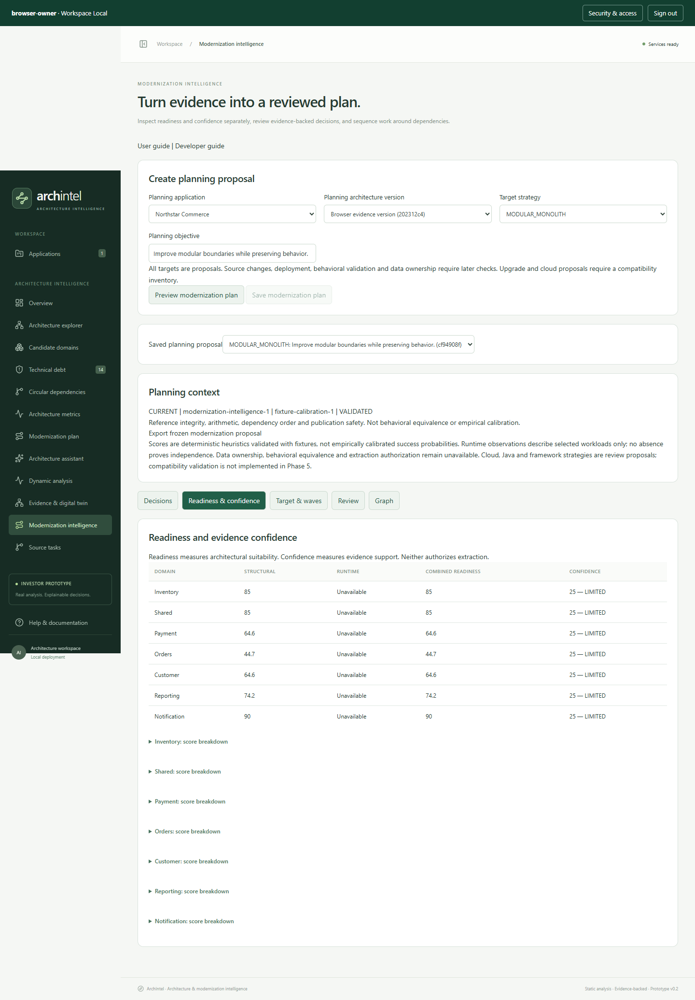

# Phase 5: Modernization intelligence

Phase 5 turns a captured architecture version into a reviewable modernization proposal. It does not edit source code or execute a modernization wave.

## Start

1. Open ArchIntel at `http://127.0.0.1:8000` and sign in.
2. Complete a static analysis. Optionally collect real runtime sessions against that exact baseline.
3. In **Evidence & digital twin**, preview and save an architecture version. Review domain membership there if you have validated the candidate boundaries.
4. Open **Modernization intelligence**. Select the application and captured architecture version.
5. Choose a target strategy and describe the planning objective.
6. Click **Preview modernization plan**. Review the proposed decisions and validation result, then **Save modernization plan**.

Saving the same version, objective, strategy and rules returns the existing proposal. Changing the objective or strategy creates another immutable proposal. Preview does not save a proposal.

## Understand the results

New proposals open on **Decision brief**. It states the selected strategy came from the user, summarizes the captured evidence scope, compares all six strategy options, and surfaces evidence-backed risks, unknowns and questions for the next discovery step. Strategy statuses describe whether current evidence supports review, is conditional, or is insufficient; they are not success probabilities, cost estimates, or a ranking. Finding references include the underlying finding text. No automatic winner is selected.

**Decisions** shows an action and blockers for each domain. **Explain why** traces the action to findings and supporting facts. Fact links open canonical provenance, including retained or expired span references. The export contains all evidence IDs; the UI shows at most 50 fact links per explanation.

**Readiness & confidence** separates architecture suitability from strength of evidence:

- Structural readiness preserves the existing baseline score unless domain membership was reviewed; reviewed domains are recomputed.
- Runtime readiness is unavailable when no mapped outgoing calls support a score.
- Combined readiness uses 60% structural and 40% runtime when runtime is available; otherwise it retains structural readiness.
- Observation gaps lower confidence rather than multiplying readiness by coverage.
- Confidence is an explainable heuristic index, not a probability of modernization success. Behavioral validation and data ownership remain unknown in Phase 5.

A high readiness score does not approve extraction. Sparse observations do not prove unused classes or independent services.

## Targets and waves

Supported planning strategies are modular monolith, microservices, hybrid, cloud refactor, Java upgrade and framework upgrade. Modular monolith proposes in-process boundaries. Distributed targets leave deployment and contracts undecided pending review. Cloud and upgrade strategies require a compatibility inventory and receive manual-review decisions; this phase does not claim compatibility analysis.

Waves put dependency domains before their consumers. Cyclic groups remain together for remediation. Each wave includes readiness, confidence, difficulty, dependencies, prerequisites, blockers and a proposed impact. Impact remains a hypothesis until later source changes are validated.

## Review

Open **Review**, choose **APPROVED_PLANNING**, **CHANGES_REQUESTED** or **REJECTED**, and provide a note. Review history records the actor, time and revision. If another review was saved, refresh before submitting again.

Planning approval records agreement with the proposal. It does not authorize code changes, extraction or deployment. To change the strategy or objective, create another proposal. To change boundaries or evidence, capture a new architecture version and generate a new proposal.

The latest captured version for the application defines current planning context. Older proposals show **SUPERSEDED** and cannot receive new reviews. They remain readable and exportable. The exported proposal is frozen; current context and review history are separate from it.

## Share a consolidated PDF report

After saving a modernization proposal, open it in **Modernization intelligence** and choose **Download consolidated PDF report**. The PDF brings together the source artifact and static-analysis summary, selected runtime sessions and coverage, digital-twin fingerprint and counts, domain readiness/confidence, modernization decisions and blockers, proposed waves, strategy alternatives, unresolved questions, and the human-review state. It identifies the analysis, architecture version and proposal used to create it.

The PDF is a readable summary: it shows the highest-priority 25 static findings and up to 100 domain decisions. Use the static analysis and frozen proposal JSON exports for complete machine-readable details. The report distinguishes user-selected strategy and heuristic assessments from validated outcomes; it does not claim that code was changed, services were extracted, or deployment was successful. A static-only version says runtime evidence is unavailable.

## Graph and recovery

**Graph** shows a separate persistent planning graph linking assessments, decisions, findings, fact/evidence references, prerequisites, blockers and waves. It preserves the Phase 4 evidence graph. Select a node or click a relationship to explore a bounded neighborhood.

If Neo4j is unavailable, the saved proposal, explanations, reviews and exports remain available from PostgreSQL. Restore Neo4j and click **Rebuild planning graph**. The displayed projection status is the last attempt; opening the graph checks current content. Planning projections are retried manually in this release.

## Permissions and limits

- Reading plans requires `ANALYSIS_READ`; creation and review require `ANALYSIS_WRITE`.
- Versions containing runtime evidence additionally require `RUNTIME_READ`, including explanations and exports.
- No model is invoked by this workflow. The existing AI gateway and user policy remain unchanged.
- Planning supports up to 500 domains and 30,000 dependency facts per captured version, with bounded graph display.
- Consolidated PDF download is available for a saved modernization proposal and requires the same analysis/runtime read permissions as its version.
- Missing source/build linkage, behavioral contracts, data ownership and human change approval remain explicit prerequisites. No **EXTRACT_NOW** decision is published by Phase 5.

## Suggested verification

Create a static-only plan: runtime readiness should be **Unavailable**, and observation gaps should be visible. Inspect an explanation and open its fact provenance. Approve the planning proposal, then capture a successor version: the old proposal should become historical and reject further reviews. Confirm the original static report and evidence export remain unchanged.

